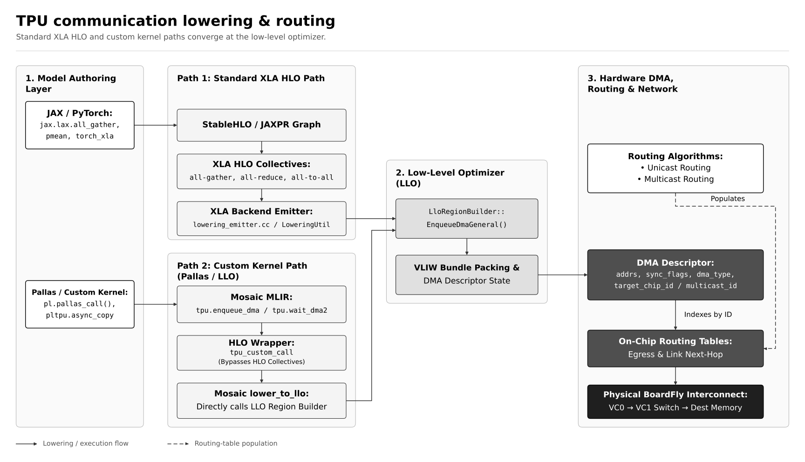

# TPU communication lowering and routing

The supplied architecture flowchart, drawn in grey, white, and black. Both the
standard XLA HLO path and the custom Pallas / LLO path converge at the low-level
optimizer before reaching hardware DMA, routing tables, and the interconnect.
All 14 nodes, 13 connections, and original labels are preserved.



- [SVG](tpu-communication-flow.svg): scalable vector diagram.
- [PNG](tpu-communication-flow.png): 4800 × 2760 image for slides and documents.
- [PDF](tpu-communication-flow.pdf): vector export for printing.
- [Mermaid source](tpu-communication-flow.mmd): editable flowchart.

Solid arrows show the lowering and execution flow. The dashed **Populates** arrow
connects routing algorithms to the on-chip routing tables.

## Regenerate the exports

From the repository root, with Python 3.11 or newer:

```bash
python3 -m venv /tmp/tpu-diagram-venv
/tmp/tpu-diagram-venv/bin/python -m pip install matplotlib==3.11.2
/tmp/tpu-diagram-venv/bin/python docs/diagrams/render_tpu_communication.py
```

The [renderer](render_tpu_communication.py) reads labels, colors, connections, and
edge captions from the Mermaid file. Its fixed layout keeps the two compiler
paths stacked, with top-to-bottom steps inside each path and left-to-right flow
between stages. Mermaid viewers may arrange subgraphs differently.

Edit the Mermaid source to change the content. If nodes or connections change,
update the renderer's layout coordinates too. The renderer checks the graph
structure and rejects labels that overflow their boxes before writing exports.
