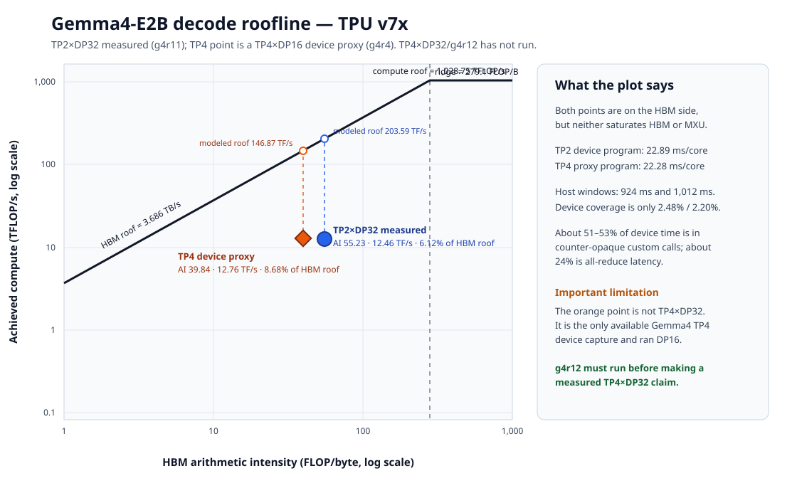

# Gemma4-E2B TP2×DP32 versus TP4×DP32 roofline

Analysis date: 2026-08-31. Platform: TPU v7x. Workload: synchronous Gemma4-E2B GRPO on OpenMathInstruct-2, 256 prompts × 8 generations = 2,048 sequences per cycle, continue-decode window 64.

## Executive verdict

TP2×DP32 is measured and remains end-to-end host/orchestration bound. TP4×DP32 is not yet measured: `g4r12` is staged but has no JobSet, pod, log, GCS artifact, or completed step. The only available Gemma4 TP4 XProf capture is `g4r4`, and its trace proves that capture ran TP4×DP16, not DP32. It is used below only as a device-side TP4 proxy.

At fixed DP32, TP4 doubles sampler devices from 64 to 128 while retaining the same 32 Python-scheduled engines. The proxy device program is only 0.61 ms (2.7%) shorter than TP2 and both programs occupy about 22–23 ms inside roughly one-second host windows. There is therefore no evidence that TP4×DP32 will improve median global-step time. Its credible hypothesis is additional aggregate KV capacity reducing rollout tails, not faster kernels.

## Evidence and provenance

| Requested mesh | Evidence used | Actual topology | Status and validity |
|---|---|---|---|
| TP2×DP32 | `g4r11` | TP2×DP32 on 64 sampler-visible logical TPU devices | 20/20 steps, exit 0, corrected bucket and sampler padfix; canonical measured TP2 point |
| TP4×DP32 | `g4r12` | Planned TP4×DP32 on the full 128-device serial sampler slice | Staged only; 0 steps and no profile |
| TP4 device proxy | `g4r4` decode XProf | **TP4×DP16** on 64 sampler-visible devices | Old image and pre-correction generation; device-shape proxy only |

The `g4r4` topology is not inferred from a filename. Its head log reports `Mesh('data': 16, 'model': 4)`, and each of `schedule`, `get_grammar_bitmask`, `update_from_output`, and `get_num_unfinished_requests` contains exactly 16 `_send_command` fan-outs in every captured window. Historical prose labeling this profile DP32 is inconsistent with the trace.

The current `g4r12` design deliberately changes to `trainer_devices_fraction=1.0` and `sampler_devices_fraction=1.0`; auto DP over the 128-device sampler view gives TP4×DP32. That makes it feasible, but it also means `g4r12` is not a pure TP-only comparison against half-slice `g4r11`.

## Device roofline

XProf's per-TensorCore TPU v7x model uses:

- Peak compute: 1,028.75 TFLOP/s.
- Peak HBM bandwidth: 3,686.156 GB/s, about 3,433 GiB/s.
- Ridge point: 279.085 FLOP/byte.

Both points have arithmetic intensity below the ridge and are therefore on the HBM side of the classical roofline.

| Metric per XProf TensorCore | TP2×DP32 (`g4r11`) | TP4 proxy, actually DP16 (`g4r4`) |
|---|---:|---:|
| Arithmetic intensity | 55.232 FLOP/B | 39.844 FLOP/B |
| Achieved normalized compute | 12.457 TFLOP/s | 12.755 TFLOP/s |
| Modeled HBM roof at that intensity | 203.593 TFLOP/s | 146.870 TFLOP/s |
| Roofline efficiency | 6.118% | 8.685% |
| Compute-peak utilization | 1.211% | 1.240% |
| Accounted HBM bandwidth | 210.046 GiB/s | 298.150 GiB/s |
| Device program time | 22.888 ms/core | 22.278 ms/core |
| XProf bound | HBM | HBM |

The higher TP4 roofline efficiency is not a throughput win: its modeled roof is lower because arithmetic intensity falls, while achieved compute and device time are essentially unchanged. TP4 partitions model work more finely but adds communication and memory movement.

## Device-time composition

| XProf category | TP2×DP32 | TP4 proxy |
|---|---:|---:|
| RPA and other custom calls | 50.957% / 11.663 ms | 53.004% / 11.808 ms |
| All-reduce | 23.929% / 5.477 ms | 24.125% / 5.375 ms |
| Convolution fusion | 11.018% / 2.522 ms | 7.508% / 1.673 ms |
| Loop fusion | 3.465% / 0.793 ms | 12.760% / 2.843 ms |
| Other identified collectives | 0.635% / 0.145 ms | 0.631% / 0.141 ms |

About half of device time is in custom calls with zero XProf FLOP/byte counters, and about one quarter is collective latency. Thus `HBM-bound` means the *accounted aggregate point* lies below the ridge; it does not mean the whole program is saturating HBM. Classical roofline analysis is incomplete for roughly three quarters of the device interval.

## Host coverage and Amdahl ceiling

| Host metric | TP2×DP32 | TP4 proxy, DP16 |
|---|---:|---:|
| Mean `llm_engine.step` window | 924.347 ms | 1,012.078 ms |
| Mean blocking `device_get` span | 783.120 ms | 846.568 ms |
| Device program / host window | 2.476% | 2.201% |
| Identified collectives / host window | 0.608% | 0.545% |

`device_get` is a synchronization span containing queueing, TPU execution, transfer, and materialization; it is not removable CPU time. In both traces, more than 97% of the host window lies outside the accounted TPU program.

| Impossible or optimistic device scenario | TP2×DP32 estimated global effect | TP4-proxy illustrative effect |
|---|---:|---:|
| Reach XProf's formal whole-program roof | save about 2.21 s; 1.018× global speedup | save about 2.00 s; 1.016× |
| Delete all captured TPU work | save about 2.36 s; 1.019× | save about 2.19 s; 1.017× |

The TP2 estimate uses `g4r11`'s 95.15 s engine and 125.43 s global medians. The TP4 column uses old `g4r4` medians and is illustrative only because that run had different code and incorrect generation. Even impossible device elimination cannot clear a 2% global-step adoption gate. Kernel tuning is therefore not the current first-order lever.

## Expected TP4×DP32 behavior

Holding DP at 32 preserves the same host fan-out as TP2×DP32, but TP4 consumes twice as many sampler devices. The available TP4 proxy shows only 1.027× device-program speedup, implying roughly 0.51× TP2's throughput per sampler device if that behavior carries over. A real full-slice run may differ because local batching, KV capacity, and the corrected sampler path change.

The plausible benefit is tail reduction: TP4 gives each DP replica twice the aggregate HBM capacity. This could reduce KV-saturation waves, but it cannot fix CPU reward-verifier spikes. In `g4r11`, rollout reached 219 s and 300 s on tail steps, while reward computation reached 251 s. Median global time was 125.43 s, but mean was 162.24 s and p90 was 325.63 s.

`g4r13` attempted TP2×DP32 with FP8 KV and a verifier timeout, but it failed on the first real generation because the FP8 cache dtype did not match the BF16 K/V tensors. Its debug hold can make the pods look active, but it produced no usable performance result. FP8 KV therefore needs a short correctness probe before it can test either tail hypothesis.

## Recommended experiment

1. Fix the FP8-cache/BF16-KV dtype mismatch, then validate FP8 KV with a short correctness probe before using it in a performance comparison.
2. For a clean fixed-DP mesh A/B, run a full-slice TP2×DP32 control with DP explicitly pinned to 32, then `g4r12` TP4×DP32. Keep every other launcher, patch, seed, KV dtype, verifier, and fraction setting identical.
3. Capture XProf and host Perfetto for both. The adoption test should require at least a 2% global-step improvement, no mean/p90 regression, and identical generation semantics.
4. Treat TP4 as a capacity/tail experiment. Continue prioritizing scheduler fan-out, output materialization, host-buffer handling, and reward-tail control over MXU/HBM kernel tuning.

## Source artifacts

- TP2 device: `gs://ubench-logs/alisachen-tpu7x/runs/g4r11/phased_profile/decode_only/dp_rank_0/plugins/profile/2026_08_31_03_30_55/server-gke-tpu-0e549f40-1sw8.0.0.xplane.pb`
- TP2 host: `gs://ubench-logs/alisachen-tpu7x/runs/g4r11/phased_profile/decode_only/dp_rank_0/plugins/profile/2026_08_31_03_30_55/gke-bodaborg-tpu7x-nap-cpu-np-7722bcae-ounk.trace.json.gz`
- TP4 proxy device: `gs://ubench-logs/alisachen-tpu7x/runs/g4r4/phased_profile/decode_only/dp_rank_0/plugins/profile/2026_08_25_08_32_00/server-gke-tpu-85455c26-rjsg.0.0.xplane.pb`
- TP4 proxy host: `gs://ubench-logs/alisachen-tpu7x/runs/g4r4/phased_profile/decode_only/dp_rank_0/plugins/profile/2026_08_25_08_32_00/gke-bodaborg-tpu7x-nap-cpu-np-7722bcae-mg47.trace.json.gz`
- Planned TP4×DP32 config: `gemma4/g4r12-envs.yaml` at commit `bfa0ce573383af0728c65ed22b45c90080bdb978`.
