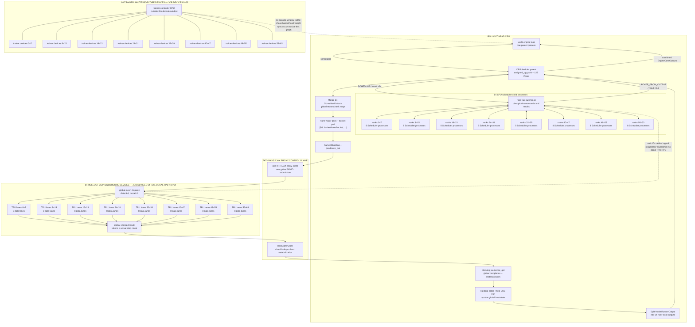
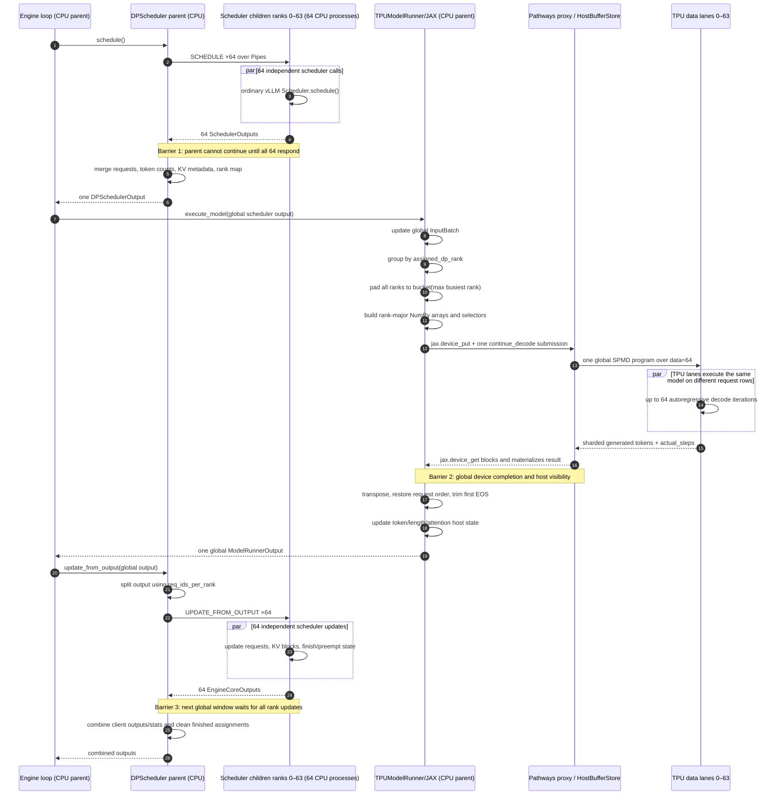

# How DP scheduling works end to end on G4R7B

This document traces one decode-time window through vLLM TPU inference, `DPScheduler`, JAX, and Pathways. It covers every rollout CPU scheduler rank and accounts for all 128 job devices: 64 trainer devices outside the decode path and 64 sampler devices executing the decode window.

> [!IMPORTANT]
> G4R7B was a 128-device **job**, but not a DP128 rollout. The job was split 50/50: 64 devices for training and 64 for sampling. The rollout topology recorded in the head log was **TP1 × DP64**, with `Mesh('data': 64, 'model': 1)` and 64 `DPScheduler` children. DP128 is only a counterfactual scaling case.

Companion: [interactive HTML/SVG explanation](./G4R7B_PATHWAYS_DP_SCHEDULER.html).

## Executive model

There are 64 logical data-parallel ranks, but there are not 64 independent model engines or Pathways clients.

| Component | Count | Runs where | Owns |
|---|---:|---|---|
| vLLM engine/model-runner parent | 1 | Rollout head CPU | Global request batch, model runner, JAX state, Pathways client |
| `DPScheduler` parent | 1 | Same head CPU process | Request-to-rank map, Pipe endpoints, merge/split logic |
| Scheduler children | 64 | 64 forked CPU processes | One ordinary vLLM `Scheduler` and logical KV allocation per DP rank |
| Logical DP ranks | 64 | JAX mesh axis `data=64` | A rank-major request slice and corresponding KV-cache shard |
| JAX/Pathways submission | 1 per decode window | Parent → proxy | One global SPMD program across the full mesh |
| Trainer JAX/TensorCore devices | 64 | First half of the job allocation | Training state; no participation in a rollout decode window |
| Rollout JAX/TensorCore devices | 64 | Last half of the job allocation | Model execution for local data lanes 0–63 |

The shortest correct mental model is:

```text
64 CPU schedulers decide independently
                 ↓ wait for all 64
one CPU parent merges, groups, and pads their work
                 ↓
one JAX/Pathways program executes across TPU lanes 0–63
                 ↓ wait and materialize
one CPU parent processes and splits the result
                 ↓ wait for all 64
64 CPU schedulers update independently
```

## Component interaction graph

Solid arrows are actual control/data movement. The dotted arrow means scheduler rank IDs determine tensor/KV ownership, but scheduler children do **not** call their corresponding TPUs directly.



The eight scheduler boxes cover ranks 0 through 63, eight processes per box. The eight rollout-device boxes cover local TPU data lanes 0 through 63 and all participate in the same global JAX program. The eight trainer-device boxes cover the other 64 allocated devices; they do not participate in the decode call because G4R7B is synchronous and separates rollout from training.

## One decode-window sequence



The sequence diagram intentionally omits the 64 trainer devices after showing them in the topology graph: there are no trainer-device messages on the decode-window critical path. They become relevant at the later training and weight-synchronization phase boundaries.

## Detailed code trace

The links below are pinned to `tpu-inference@f6ad5ecb1ca359c721b01fd0d7edd90b5cf0ac7e` (2026-08-30). G4R7B did not record an exact `tpu-inference` commit stamp, so this is the matching current architecture, not a claim that every line is byte-identical to the run image.

### 0. Pathways selects single-process SPMD DP

Pathways rejects native vLLM multiprocess DP and requires V1 multiprocessing to be disabled:

- [`TPU_MULTIPROCESS_DP` Pathways gate](https://github.com/vllm-project/tpu-inference/blob/f6ad5ecb1ca359c721b01fd0d7edd90b5cf0ac7e/tpu_inference/platforms/tpu_platform.py#L270-L308)
- [retain logical model DP, reset upstream vLLM DP to one](https://github.com/vllm-project/tpu-inference/blob/f6ad5ecb1ca359c721b01fd0d7edd90b5cf0ac7e/tpu_inference/layers/common/sharding.py#L297-L319)

The custom sharding configuration keeps `data_parallelism=64`, but upstream `parallel_config.data_parallel_size` becomes one so vLLM does not create 64 model engines. `DPScheduler` later reads DP64 from `sharding_config.total_dp_size`.

### 1. Fork 64 CPU-only scheduler workers

[`DPScheduler.__init__`](https://github.com/vllm-project/tpu-inference/blob/f6ad5ecb1ca359c721b01fd0d7edd90b5cf0ac7e/tpu_inference/core/sched/dp_scheduler.py#L397-L514) creates one ordinary vLLM scheduler per logical rank using `multiprocessing.get_context('fork')`.

Each child has:

- one input Pipe and one output Pipe;
- an ordinary vLLM `Scheduler`;
- a logical KV-cache configuration with `global_blocks // 64` blocks;
- a deque caching its most recent `SchedulerOutput`;
- no model weights, JAX model execution, or Pathways client.

Commands and results are serialized with `cloudpickle`. The [child command loop](https://github.com/vllm-project/tpu-inference/blob/f6ad5ecb1ca359c721b01fd0d7edd90b5cf0ac7e/tpu_inference/core/sched/dp_scheduler.py#L143-L251) handles admission queries, `SCHEDULE`, grammar, updates, finish signals, stats, and request-count queries.

### 2. Route each request to one sticky rank

For every new request, [`_find_best_rank_for_request`](https://github.com/vllm-project/tpu-inference/blob/f6ad5ecb1ca359c721b01fd0d7edd90b5cf0ac7e/tpu_inference/core/sched/dp_scheduler.py#L701-L740) asks every rank for:

1. computed prefix-cache blocks;
2. pending prefill tokens;
3. running and waiting request counts;
4. minimum remaining output capacity.

The selected score is effectively:

```python
load = pending_prefill_tokens + max(0, request_tokens - cached_tokens)
score = (load, running + waiting, min_remaining_output)
```

The winner becomes sticky in `assigned_dp_rank[request_id]`. The parent sends one `ADD_REQUEST` command to that child and waits for acknowledgment.

Batch-prefill mode buffers 64 requests, but [`_flush_pending`](https://github.com/vllm-project/tpu-inference/blob/f6ad5ecb1ca359c721b01fd0d7edd90b5cf0ac7e/tpu_inference/core/sched/dp_scheduler.py#L755-L776) still routes them one at a time. It is buffering, not bulk routing.

For 2,048 requests with prefix caching:

```text
exchanges = R × (4D + 1)
          = 2,048 × (4×64 + 1)
          = 526,336 request/reply exchanges

one-way Pipe messages = 1,052,672
```

This is code-derived algorithmic exposure, not a measured trace count.

### 3. Schedule every rank and rendezvous

[`DPScheduler.schedule`](https://github.com/vllm-project/tpu-inference/blob/f6ad5ecb1ca359c721b01fd0d7edd90b5cf0ac7e/tpu_inference/core/sched/dp_scheduler.py#L811-L973) sends `SCHEDULE` to all 64 children. Each child schedules against only its own requests and logical KV state.

[`_collect_results_unordered`](https://github.com/vllm-project/tpu-inference/blob/f6ad5ecb1ca359c721b01fd0d7edd90b5cf0ac7e/tpu_inference/core/sched/dp_scheduler.py#L644-L661) collects whichever Pipe is ready first, but ultimately waits for all 64:

```text
schedule barrier = max(rank_0 latency, ..., rank_63 latency)
```

The parent merges all lists, dictionaries, token counts, finished IDs, KV metadata, and request/rank mappings into one `DPSchedulerOutput`.

### 4. Maintain one global host batch

The TPU runner owns one persistent global `InputBatch`. [`_init_inputs`](https://github.com/vllm-project/tpu-inference/blob/f6ad5ecb1ca359c721b01fd0d7edd90b5cf0ac7e/tpu_inference/runner/tpu_runner.py#L1037-L1128) derives:

```text
max_num_reqs = DP × max_num_seqs
             = 64 × 256
             = 16,384
```

This is maximum capacity/metadata sizing, not the number of real requests in each window.

### 5. Group by rank and pad to the busiest lane

[`_prepare_input_metadata`](https://github.com/vllm-project/tpu-inference/blob/f6ad5ecb1ca359c721b01fd0d7edd90b5cf0ac7e/tpu_inference/runner/tpu_runner.py#L2393-L2488) groups active requests by `assigned_dp_rank` and computes:

```python
max_num_reqs_across_dp = max(request_count_per_rank)
max_tokens_across_dp = max(scheduled_tokens_per_rank)
```

For continue-decode:

```text
B = request_bucket(max_num_reqs_across_dp)
global request rows = 64 × B
```

Example:

```text
rank 0: [A B C _ _]
rank 1: [D E F G H]  ← busiest rank has five
rank 2: [I J _ _ _]
rank 3: [K L M N _]
```

The real implementation may round five to a larger supported compilation bucket. Selector arrays remember how to restore the original global request order.

One G4R7B decode snapshot had:

```text
1,404 active requests
2,048 padded rows = 64 × 32
68.55% occupancy
644 dummy rows
21.94 active requests/rank on average
```

The dummy rows are masked, but they still enlarge host metadata, tensor shapes, transfers, and any device work that does not fully elide them.

### 6. Build rank-major host arrays

[`_prepare_inputs`](https://github.com/vllm-project/tpu-inference/blob/f6ad5ecb1ca359c721b01fd0d7edd90b5cf0ac7e/tpu_inference/runner/tpu_runner.py#L2655-L2857) fills rank slices for:

- input token IDs and positions;
- query start locations and sequence lengths;
- logits selectors and active masks;
- sampling metadata;
- request-distribution metadata;
- logical KV block tables;
- padding and original-order selectors.

This work is performed by the one parent using Python and NumPy loops over all ranks and requests.

### 7. Cross the JAX/Pathways boundary

[`device_array`](https://github.com/vllm-project/tpu-inference/blob/f6ad5ecb1ca359c721b01fd0d7edd90b5cf0ac7e/tpu_inference/utils.py#L379-L394) delegates to `jax.device_put` with `NamedSharding`. With `JAX_PLATFORMS=proxy`, Pathways handles global placement and dispatch.

This produces one global operation over `Mesh('data':64, 'model':1)`, not 64 remote model calls.

### 8. Run one fused decode loop across all 64 TPUs

[`_execute_continue_decode`](https://github.com/vllm-project/tpu-inference/blob/f6ad5ecb1ca359c721b01fd0d7edd90b5cf0ac7e/tpu_inference/runner/tpu_runner.py#L1759-L1954) invokes one JIT-compiled `continue_decode` program. G4R7B configured a static window of 64 token iterations.

Each TPU data lane runs the same TP1 model on its own rank-major request rows. All lanes participate in the same global SPMD program. A cap-4,096 sequence can require up to 64 such windows; shorter and EOS-finished requests require fewer.

### 9. Block and materialize the global output

In the synchronous path, [`_process_continue_decode_outputs`](https://github.com/vllm-project/tpu-inference/blob/f6ad5ecb1ca359c721b01fd0d7edd90b5cf0ac7e/tpu_inference/runner/tpu_runner.py#L191-L349) calls:

```python
generated_tokens_cpu, actual_steps_cpu = jax.device_get(
    (generated_tokens, actual_steps)
)
```

This interval includes Pathways queueing, TPU completion, remote shard lookup, transfer, and host materialization. It is not pure CPU work and not pure device compute.

The parent then transposes the `[steps, rank-major rows]` result, applies the selector, and scans each request for its first EOS using [`_extract_valid_tokens_host`](https://github.com/vllm-project/tpu-inference/blob/f6ad5ecb1ca359c721b01fd0d7edd90b5cf0ac7e/tpu_inference/runner/tpu_runner.py#L146-L155). It updates token lists, sequence lengths, attention metadata, logprobs, and host batch state.

### 10. Split and update all 64 scheduler children

[`_split_model_output_by_rank`](https://github.com/vllm-project/tpu-inference/blob/f6ad5ecb1ca359c721b01fd0d7edd90b5cf0ac7e/tpu_inference/core/sched/dp_scheduler.py#L1248-L1319) uses `req_ids_per_rank` to construct 64 rank-local `ModelRunnerOutput` objects.

[`update_from_output`](https://github.com/vllm-project/tpu-inference/blob/f6ad5ecb1ca359c721b01fd0d7edd90b5cf0ac7e/tpu_inference/core/sched/dp_scheduler.py#L1135-L1208) sends one object to each child. Every child pops the `SchedulerOutput` cached during scheduling, corrects multi-token continue-decode counts, and invokes the ordinary vLLM scheduler update. This advances request states and allocates/frees logical KV blocks.

The parent again waits for all 64 children, combines `EngineCoreOutputs` and stats, and removes finished requests from `assigned_dp_rank`.

### 11. Repeat the global window

The next window cannot begin until scheduling, global execution, host processing, and rank updates have completed. The control sequence repeats until no requests remain.

Definite schedule/update Pipe traffic per window is:

```text
SCHEDULE command + response: 2D = 128 one-way messages
UPDATE command + response:   2D = 128 one-way messages
total:                       4D = 256 one-way messages/window
```

Grammar and unfinished-request broadcasts can add two more all-rank request/reply pairs:

```text
full surrounding control sequence: approximately 8D = 512 messages
```

## Measured decode-window evidence

The host trace contains seven complete engine windows in profiled outer step 0. These are inclusive, overlapping spans and must not be summed.

| Span/event | Mean per window | Interpretation |
|---|---:|---|
| `llm_engine.step` | 774.10 ms | Full host envelope |
| runner `execute_model` | 699.67 ms | Runner execution envelope |
| process continue-decode outputs | 644.60 ms | Materialization plus output handling |
| blocking `jax.device_get` | 545.22 ms | Proxy queue/completion/lookup/transfer/materialization |
| first-EOS extraction | 66.95 ms | 9,707 per-request calls over seven windows |
| prepare inputs | 33.53 ms | Host rank-major metadata construction |
| scheduler update | 31.76 ms | All-rank update envelope |
| scheduler schedule | 12.54 ms | Six complete spans because of trace boundary |
| continue-decode submission | 2.95 ms | Host dispatch envelope |
| captured TPU program | 15.99 ms | Separate XProf active device interval |

Additional measured activity per host window:

- 130 `HostBufferStore::Lookup` events;
- approximately 772 `StoreAsync` events;
- approximately 232 `DPScheduler._send_command` spans;
- four rare rank-scheduler stalls of 0.89–1.40 seconds in the head log;
- 335 cold/early long `update_from_output` warnings.

The ratio `15.99 / 774.10 = 2.07%` is a **coverage proxy**, not TPU utilization. XProf reports approximately 99% duty and 0.447% explicit idle inside the short active device interval. The system-level gap occurs primarily around and between launches.

## Why DP64 exposes a host/control-plane roof

The useful work per lane falls as DP increases:

```text
initial full batch: 2,048 / 64 = 32 requests/rank
profile snapshot:   1,404 / 64 ≈ 21.94 active requests/rank
```

But surrounding work remains serial or grows with DP:

| Term | Scaling tendency |
|---|---|
| Admission rank probes | `O(requests × DP)` |
| Scheduler processes and Pipe endpoints | `O(DP)` |
| Schedule/update messages | `O(DP)` per window |
| Barrier latency | Slowest of 64 children |
| Padded global shape | `DP × bucket(busiest rank)` |
| Rank-major host construction | Global parent loops over all ranks/requests |
| Pathways result fan-in | One host-visible global dependency chain |
| First-EOS/state processing | One parent scans all live requests |

This is why “host-bound” does not mean all CPU cores are saturated. Follow-up rollout observation used only 0.9–2.1 of 44 head CPU cores. Forward progress is bound by a mostly serial orchestration, synchronization, and materialization chain.

## Improvement order implied by the trace

1. Add correlated host/device/window IDs and separate CPU work, proxy queueing, remote execution, lookup, transfer, and materialization inside `device_get`.
2. Replace per-request × per-rank admission probes with a prompt-group-aware load snapshot plus bulk `ADD_REQUESTS`, preserving the eight-generation prefix-sharing group.
3. Vectorize first-EOS extraction and host state updates; preserve byte-identical token IDs, EOS inclusion, lengths, and finish reasons.
4. Right-size `max_num_seqs` and make block-table updates persistent/sparse instead of zeroing and repacking maximum-sized metadata each window.
5. Replace cloudpickled object graphs with compact fixed-schema or shared-memory scheduler messages; avoid grammar/unfinished broadcasts when not needed.
6. Experiment with device-side output compaction or coarser output sharding to reduce HostBufferStore fan-in before `device_get`.
7. Only after correctness-safe host wins, prototype process-parallel output handling or multiple supported Pathways coordinators over disjoint submeshes.
8. Tune TPU kernels only after the host/device coverage ratio improves.

Do not simply enable `TPU_MULTIPROCESS_DP`: the current Pathways platform explicitly rejects it. Do not adopt naive round-robin routing: the measured experiment destroyed prefix/load locality and regressed rollout. Do not claim that `device_get` is 545 ms of CPU work or that the 2.07% coverage proxy is TPU utilization.

## Sources

- G4R7B head log: `gs://alisachen/tpu_rl/ironwood/logs/g4r7b-head.log`
- Run artifacts: `gs://ubench-logs/alisachen-tpu7x/runs/g4r7b/`
- Host trace: `phased_profile/decode_only/dp_rank_0/plugins/profile/2026_08_27_12_05_59/gke-bodaborg-tpu7x-nap-cpu-np-7722bcae-mg47.trace.json.gz`
- [Gemma4 performance report](./GEMMA4_PERF_REPORT.md)
- [Corrected detailed headroom analysis](../g4r7b_analysis/perf_headroom.md)
- Code trace: [`vllm-project/tpu-inference@f6ad5ecb`](https://github.com/vllm-project/tpu-inference/commit/f6ad5ecb1ca359c721b01fd0d7edd90b5cf0ac7e)
