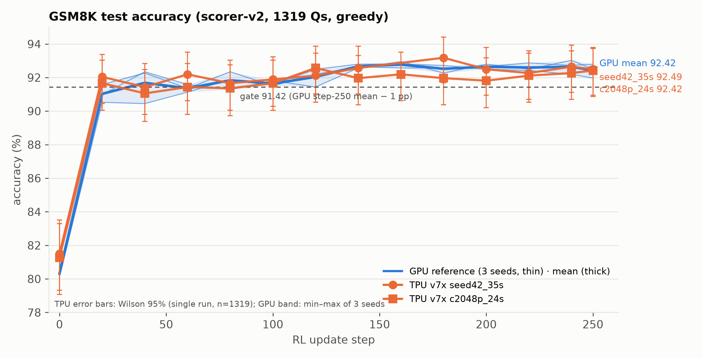
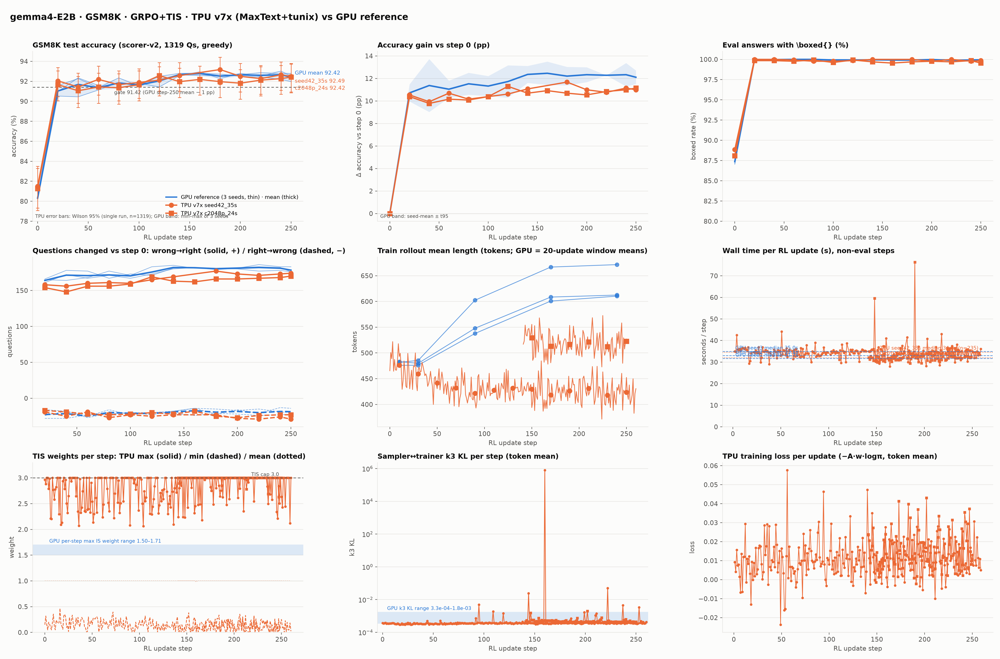

# gemma4-E2B GSM8K RL: GPU ↔ TPU accuracy-parity check of the **24 s performance configuration**

**Result (2026-10-29): parity reached.** The TPU run that carries the performance levers of the
optimized ~24 s/step recipe reproduces the frozen GPU reference curve: step-250 accuracy **92.42 %**
vs the GPU 3-seed mean **92.42 ± 0.42 %** (gate ≥ 91.42 % **passed**, margin +1.00 pp); 14 of 14 eval
points within ±1 pp of the GPU mean (largest deviation +0.96 pp, at step 0 before any update).
Same standard, same benchmark method and the same nine comparison items as the 35 s recipe check
([`GEMMA4_E2B_GPU_TPU_PARITY_REPORT.md`](GEMMA4_E2B_GPU_TPU_PARITY_REPORT.md)).


---

## 1. The standard for accuracy parity (unchanged)

| element | definition |
|---|---|
| **Metric** | scorer-v2 accuracy on the GSM8K **test** split (1319 questions), greedy decode (`eval_temperature=0.01, top_k=1`, stop ids `[1, 106, 50]`): `acc = share of answers whose last \boxed{…} equals the gold`. Identical scorer file on both platforms (`boxed_math_reward_v2.compute_score`, hash-verified against the GPU fixture). |
| **Reference** | the frozen GPU runs `gemma4_e2b_gsm8k8k_16n64g_s250_seed{1,2,3}` (verl + vLLM, 16 × 8 GPUs, FSDP): per-eval `acc_v2` with Wilson 95 % intervals, boxed rate, response tokens, question flips; per-step k3 KL, ESS, IS-weight max; per-seed step time. 3-seed step-250 mean 92.42 %, SD 0.42, seeds 91.96 / 92.49 / 92.80. |
| **Gate** | fixed-step-250 V2 accuracy: **TPU ≥ GPU mean − 1 pp = 91.42 %** (absolute, at step 250, not the best step). |
| **Curve** | every TPU eval point (0, 20, …, 240, 250) within **±1 pp of the GPU mean**, judged against the single-run Wilson 95 % half-width (±1.4 pp at n = 1319) and the GPU seed spread. |
| **Dynamics** | boxed-rate trajectory, wrong→right / right→wrong counts vs step 0, training reward per update, sampler↔trainer k3 KL and ESS, rollout length and wall time per update, compared in the same units. |
| **Not the metric** | MaxText's own eval `accuracy` (lenient `check_correctness` + `math_verify`, 90.60 % at step 250 here) is ignored. |

## 2. How the accuracy is benchmarked

**What is identical to the 35 s check (audited):** `google/gemma-4-E2B-it` (HF rev 3e22461f, same
converted checkpoint `gemma4-e2b-it-fresh`) · GSM8K train, shuffle seed 42 · native `<|turn>` template,
one `<bos>`, the same system prompt · GRPO 128 prompts × 16 samples, T = 1.0, top_p 1.0, top_k −1 ·
advantage `(R − mean)/(std + 1e-6)` · loss `−A·w·logπθ`, token-mean, no clip / KL / entropy · token-level
truncated IS `w = min(exp(clamp(logπθ − logπsampler, −20, 20)), 3)` · LR 2e-6, 10 warm-up, cosine to 0 at
250 · AdamW (0.9, 0.999), eps 1e-8, wd 0, clip 1.0 · fp32 master + fp32 Adam, bf16 compute and rollout ·
250 updates · eval every 20 updates + at the end · the 17 parity fixes (§4) applied by the same
self-applying patcher.

**What the 24 s configuration changes (the performance levers only):**

| lever | 35 s parity recipe | 24 s configuration (`g4pt1c2048p`) |
|---|---|---|
| response cap | 2560 tokens (`max_target_length` 3072) | **2048** tokens (`max_target_length` 2560 = 512 prefill + 2048) |
| splash-attention blocks | kv 1024 | q/kv **512** (1024 does not divide the 2560 sequence) |
| reward scoring | synchronous | **async** (`ASYNC_REWARD=on`: scoring overlaps the next generation) |
| DP routing of rollout requests | default | **round-robin** |
| sampling kernel | exact top-k | **approx-max-k** |
| EOS check interval | 1 | **32** |
| KV cache | freed during weight sync | **kept** (`free_kv_cache_during_weight_sync=false`), 128-token blocks |
| DVFS | p-state 7 | p-state 7 for updates 0–140, **p-state 6** for 141–250 (7 is not allowed on this cluster; corrected mid-run at a checkpoint boundary) |

Everything else in the optimized recipe (`g4ucq3`: OpenMathInstruct-2 prompts, 256 × 8 rollouts,
100 updates) is a *workload* difference, not a *system* difference, so the parity check keeps the GSM8K
training recipe: that is the only way the curve is comparable point-by-point with the GPU reference.
The optimized recipe on its own prompt set is checked separately by reward-band parity (§3.5).

**TPU stack:** MaxText `train_rl` + tunix 0.1.8 (pinned image digest `f7c957d0…`) + vLLM-TPU rollout,
Pathways, one tpu7x 4x4x4 slice (64 chips) as a Kueue JobSet; manifest
[`parity/manifests/g4pt1c2048p-seed42-24s-config.yaml`](parity/manifests/g4pt1c2048p-seed42-24s-config.yaml)
built by `parity/build_g4pt.py` with `CAP=2048 PERF=1 CKPT=1`.

**Instrumentation (head-pod stdout, mirrored to GCS):** the same lines as the 35 s check:
`EVAL-BREAKDOWN` / `EVAL-V2ACC` (parity metric + per-question JSONL `eval_<step>.jsonl`), `TIS-ACTIVE`
(sampler↔trainer mismatch per update), `RLMETRIC` (every tensorboard scalar), `REWARD-DEBUG`,
`LENDIST` / `PHASETIME` (rollout length, truncation, phase timings), `Found N checkpoint steps` /
`Restored params` / `RESUME-SYNC` (checkpoint resume path).

**Procedure:** apply the manifest, let `parity/tools/chain-seeds3.sh` handle the cluster's 120-minute
per-admission limit (delete + re-apply → checkpoint restore; four admissions here, resumes from
checkpoints 20, 60 and 140), collect `evals/eval_*.jsonl` from `gs://ubench-logs/g4pt1c2048p/`, and run
`parity/tools/make_parity_figures.py` against the GPU `aggregate_summary.json` with the 35 s seed-42
run as an overlay.

## 3. Results and evidence

### 3.1 Accuracy curve (scorer-v2, 1319 Qs)

| step | GPU mean ± SD (min–max) | TPU 24 s config [Wilson 95 %] | TPU − GPU mean | TPU 35 s recipe, seed 42 (overlay) |
|---:|---|---|---:|---|
| 0 | 80.31 ± 0.24 (80.14–80.59) | 81.27 [79.1, 83.3] | +0.96 | 81.50 |
| 20 | 91.03 ± 0.53 (90.52–91.58) | 91.66 [90.0, 93.0] | +0.63 | 92.04 |
| 40 | 91.69 ± 1.07 (90.45–92.34) | 91.05 [89.4, 92.5] | −0.64 | 91.43 |
| 60 | 91.36 ± 0.23 (91.13–91.58) | 91.43 [89.8, 92.8] | +0.07 | 92.19 |
| 80 | 91.84 ± 0.53 (91.28–92.34) | 91.36 [89.7, 92.8] | −0.48 | 91.66 |
| 100 | 91.64 ± 0.16 (91.51–91.81) | 91.66 [90.0, 93.0] | +0.02 | 91.89 |
| 120 | 92.04 ± 0.55 (91.43–92.49) | 92.57 [91.0, 93.9] | +0.53 | 92.12 |
| 140 | 92.67 ± 0.12 (92.57–92.80) | 91.96 [90.4, 93.3] (restart eval on the restored step-140 weights; 92.34 at step 141 before the pause) | −0.71 | 92.57 |
| 160 | 92.77 ± 0.19 (92.57–92.95) | 92.19 [90.6, 93.5] | −0.58 | — |
| 180 | 92.52 ± 0.23 (92.27–92.72) | 91.96 [90.4, 93.3] | −0.56 | 93.18 |
| 200 | 92.65 ± 0.15 (92.49–92.80) | 91.81 [90.2, 93.2] | −0.84 | 92.49 |
| 220 | 92.60 ± 0.24 (92.42–92.87) | 92.12 [90.5, 93.5] | −0.48 | 92.27 |
| 240 | 92.65 ± 0.42 (92.19–93.03) | 92.27 [90.7, 93.6] | −0.38 | 92.65 |
| **250** | **92.42 ± 0.42 (91.96–92.80)** | **92.42** [90.9, 93.7] | **0.00** | 92.49 |

**Gate:** 92.42 ≥ 91.42 → **PASS**. Largest deviation of any point from the GPU mean: +0.96 pp (step 0,
before any update); mean deviation over the 14 points −0.22 pp; the sign changes 5 times, i.e. no
systematic offset, and no point is distinguishable from the GPU mean at the single-run Wilson width.
The step-250 accuracy equals the GPU 3-seed mean to two decimals and sits inside the GPU seed range
(91.96–92.80).

### 3.2 Dynamics

| quantity | GPU | TPU 24 s config | TPU 35 s recipe (seed 42) |
|---|---|---|---|
| boxed rate step 0 → 20 | 87.95 % → 100 % | 88.10 % → 99.85 % (99.55–99.92 % thereafter) | 88.86 % → 100 % |
| wrong→right / right→wrong at 250 (vs step 0) | 176–183 / 14–22 | 170 / 23 | 175 / 24 |
| training reward (mean score per update, updates 141–250) | train_acc_v2 84.5 % → 92.1 % | 0.917 (141) → 0.927 (250), median 0.932, range 0.881–0.969 | 0.87 → 0.93 |
| k3 KL per update | 3.4e-4 – 5.0e-4 | 3.8e-4 – 2.0e-3 (mean 4.9e-4), no spike after the resume | 3.3e-4 – 5.0e-4 |
| ESS per update | ≥ 0.999 | ≥ 0.9986 (mean 0.9991) | 0.9993 |
| clipped IS fraction | 3.7e-6 | 4.2e-6 | ≈ 1e-6 |
| per-update max IS weight | 1.50 – 1.71 | 2.63 – 3.0 (cap) | 2.1 – 3.0 (cap) |
| rollout mean length (tokens) | 480 → 610 | ≈ 480 → 527 (cap 2048; truncated 0–2.2 %, 0.93 % at step 250) | 430 (flat, cap 2560) |
| wall time per update (median, non-eval steps) | 31.7 / 33.1 / 35.0 s | **32.1 s** (p-state 6 segment, n = 98; `run_global_step` 30.7–31.6 s at steps 142–250) | 34.6 s |

The two known, benign differences of the 35 s check remain: the TPU's per-update *maximum* importance
weight reaches the cap 3.0 (bf16 vLLM sampler vs fp32-master trainer; mean weight 1.000 and the clipped
fraction match the GPU), and TPU rollouts are shorter than the GPU's (which lengthen to ~610 tokens by
step 170). The 2048-token cap of this configuration does not bite: at most 2.2 % of rollouts are
truncated at any update and eval answers are 1430–1580 characters, the same range as the GPU.

### 3.3 Figures

High-resolution (300 dpi) versions: [`parity/figures_24s_config/hires/`](parity/figures_24s_config/hires/);
summary table: [`parity/figures_24s_config/parity_summary.md`](parity/figures_24s_config/parity_summary.md).


*Accuracy vs update. Blue: GPU seeds (thin), mean (thick), min–max band. Orange: the TPU 24 s configuration (squares) and the 35 s seed-42 overlay (circles) with Wilson 95 % bars. Dashed: the 91.42 gate.*


*All nine panels: accuracy, gain vs step 0, boxed rate, question flips, rollout length, wall time, TIS weights, k3 KL, loss. Panels 5–9 show the 24 s run from update 141 (only the final segment's stdout was retained; the evaluation dumps behind panels 1–4 cover all 15 evaluations). The single k3 spike at step 160 belongs to the 35 s seed-42 overlay (documented in that report), not to this run.*

### 3.4 Log evidence

Full extracts: [`parity/logs/seed42_g4pt1c2048p_24s_config_key_lines.log`](parity/logs/seed42_g4pt1c2048p_24s_config_key_lines.log);
per-question dumps: [`parity/evals_24s_config/`](parity/evals_24s_config/) (`eval_000 … eval_250.jsonl`,
mirrored from `gs://ubench-logs/g4pt1c2048p/evals/`).

Patch applied at pod start, and what the scorer sees (same patcher as the 35 s check):

```
TIS-PARITY PATCH: APPLIED (train_rl: sampler_is=token thr=3.0, return_logprobs=True, eval full-coverage drop_remainder=False, rollout bf16, RLMETRIC stdout mirror; grpo_learner TIS-ACTIVE(+k3/ess) stdout; evaluate_rl EVAL-V2ACC step-named dumps; checkpoint_manager RNG-free resumable ckpt; rl_learner resume-sync; max_steps=num_batches)
PARITY-PROMPT '<|turn>system\nYou are a helpful assistant. Please reason step by step, and put your final answer within \\boxed{}.<turn|>\n<|turn>user\nJame gets 20 singing lessons. …'
REWARD-DEBUG n=1 answer_type=list gold0=np.str_('["300"]') gold_str0='300' n_correct=1 n_boxed_wrong=0 n_zero=0 tail0='… $$\\boxed{300}$$<turn|>'
```

Eval lines across the four admissions (UTC times from the chain log; periodic evals land at step+1,
restart evals at the exact checkpoint step):

```
[05:55] Found 0 checkpoint steps                      EVAL-BREAKDOWN step=0   k=0 total=1319 acc=81.27% boxed_wrong=6.90% nobox=11.83% mean_chars=1426
[06:39]                                               EVAL-BREAKDOWN step=21  k=1 total=1319 acc=91.66%
[06:49]                                               EVAL-BREAKDOWN step=41  k=2 total=1319 acc=91.05%
[06:59]                                               EVAL-BREAKDOWN step=61  k=3 total=1319 acc=91.43%
[07:19]                                               EVAL-BREAKDOWN step=81  k=4 total=1319 acc=91.36%
[07:29]                                               EVAL-BREAKDOWN step=101 k=5 total=1319 acc=91.66%
[07:39]                                               EVAL-BREAKDOWN step=121 k=6 total=1319 acc=92.57%
[07:58]                                               EVAL-BREAKDOWN step=141 k=7 total=1319 acc=92.34%
[07:58] RESUME: deleting JobSet and re-applying g4pt1c2048p.yaml (latest ckpt: 140)   (120-min limit; slot then used for the p-state-6 perf reruns)
[10:48] Found 7 checkpoint steps / Restored params from step: 140 in 19.568 seconds
        RESUME-SYNC pushing restored actor weights (global_steps=140) to the rollout engine before the first generation
[10:54]                                               EVAL-BREAKDOWN step=140 k=0 total=1319 acc=91.96% boxed_wrong=7.73% nobox=0.30% mean_chars=1575   (restart eval, restored weights)
[11:24]                                               EVAL-BREAKDOWN step=160 k=1 total=1319 acc=92.19% boxed_wrong=7.35% nobox=0.45% mean_chars=1554
[11:34]                                               EVAL-BREAKDOWN step=180 k=2 total=1319 acc=91.96% boxed_wrong=7.73% nobox=0.30% mean_chars=1556
[11:55]                                               EVAL-BREAKDOWN step=200 k=3 total=1319 acc=91.81% boxed_wrong=7.96% nobox=0.23% mean_chars=1542
[12:05]                                               EVAL-BREAKDOWN step=220 k=4 total=1319 acc=92.12% boxed_wrong=7.58% nobox=0.30% mean_chars=1552
[12:15]                                               EVAL-BREAKDOWN step=240 k=5 total=1319 acc=92.27% boxed_wrong=7.58% nobox=0.15% mean_chars=1540
[12:24]                                               EVAL-BREAKDOWN step=250 k=6 total=1319 acc=92.42% boxed_wrong=7.13% nobox=0.45% mean_chars=1560
        EVAL-V2ACC total=1319 v2_acc=92.4185% mean_reward=0.9313
        Post RL Training: corr=1195, total=1319, accuracy=90.60%, partial_accuracy=91.81%, mean_reward=0.9313   (MaxText's lenient metric, not the parity metric)
        EXIT_CODE=0
```

Sampler↔trainer mismatch right after the resume (on-policy from the first restored batch, because of
the `RESUME-SYNC` fix) and at the end:

```
TIS-ACTIVE weight_mean=0.99999 weight_min=0.14995 weight_max=2.96637 frac_clipped=0.000000 k3_kl=3.6529e-04 ess=0.999302 logratio_mean=-3.5757e-04 logratio_absmean=6.5978e-03 ntok=953392
RLMETRIC 'rewards' 'mean' 0.917139 'train' 141
…
RLMETRIC 'rewards' 'mean' 0.927002 'train' 250
TIS summary over updates 141–250: n=110, k3_kl 3.8e-4 … 2.0e-3 (mean 4.9e-4), ess ≥ 0.9986, frac_clipped mean 4.2e-6, weight_max 2.63 … 3.0
```

Rollout length / truncation at the 2048 cap and the steady-state phase timings:

```
LENDIST step=250 n=2048 cap=2048 truncated=19 (0.93%) eos_at_cap=0 osl_mean=527.0 isl_mean=95.4   (truncation range over 141–250: 0.00% … 2.20%)
PHASETIME step=141 … run_global_step=899.43   (first update after the resume: compile + rollout-engine warm-up, excluded from step-time statistics)
PHASETIME step=142 compute_rewards=0.20 engine_generate=26.35 generate_and_advantage=28.38 micro_batch_steps=31.00 prepare_data=28.99 run_global_step=31.00
PHASETIME step=250 compute_rewards=0.20 engine_generate=27.15 generate_and_advantage=29.25 micro_batch_steps=31.60 prepare_data=29.86 run_global_step=31.60
```

### 3.5 Relation to the optimized recipe's own benchmark

The optimized recipe itself (`g4ucq2` at p-state 7, `g4ucq3` at p-state 6: OpenMathInstruct-2,
256 × 8 rollouts, 100 updates) is checked by reward-band parity against the GPU verl band
(`check_numbers` 0.50–0.57): **0.5118** on both p-states, `score/mean` 0.58, KL 0, step time 23.9 s
(p-state 7) / **25.3 s** (p-state 6) median —
[`GEMMA4_E2B_OPTIMIZED_RECIPE_PARITY_REPORT.md`](GEMMA4_E2B_OPTIMIZED_RECIPE_PARITY_REPORT.md).
This report closes the remaining question: the *system* levers that make it fast do not change what is
learned on the parity benchmark.

## 4. What we fixed to get here

The run inherits the 17 parity fixes of the 35 s check (§4 of
[`GEMMA4_E2B_GPU_TPU_PARITY_REPORT.md`](GEMMA4_E2B_GPU_TPU_PARITY_REPORT.md): real training reward, TIS
active, full-coverage eval, scorer-v2 metric, fp32 master/Adam, 250-step schedule, RNG-free resumable
checkpoints, resume weight sync, non-default Pathways ports, 120-minute-limit chain, uncommitted-checkpoint
cleanup, step-named eval dumps). Specific to the 24 s configuration:

| # | symptom | root cause | fix |
|---|---|---|---|
| 1 | crash at the first TIS recompute: `q_block_size=1024 should divide q_seq_len=2560` | the 2048 cap makes the unpacked recompute length 2560, which the 35 s recipe's 1024 splash blocks do not divide | `sa_block_q/kv` 512 when `CAP=2048` (`build_g4pt.py`) |
| 2 | `--xla_tpu_dvfs_p_state=7` not allowed on the cluster | manifests inherited p-state 7 from the perf ladder | rebuilt every manifest with p-state 6; this run resumed under the corrected manifest at checkpoint 140 (restart eval 91.96 % vs 92.34 % one update earlier confirms the weights), 110 of 250 updates measured at p-state 6 |
| 3 | the chain re-applied the parity job into the slot reserved for the p-state-6 perf reruns | deactivation race between the chain's resume and the perf orchestrator | chain restricted to explicit `NAMES=…`; orchestrator runs the perf jobs first and then hands the slot back to the chain |
| 4 | only the last segment's stdout survived (dynamics panels start at update 141) | the chain truncates the raw log on every re-apply | evaluation dumps on GCS are complete (all 15); a truncation-proof log keeper is used for later runs |

What did **not** need changing: all recipe constants (§2), the scorer, eval decoding, the chat template,
the checkpoint, and the patcher.

## 5. Reproduce

* Manifest: [`parity/manifests/g4pt1c2048p-seed42-24s-config.yaml`](parity/manifests/g4pt1c2048p-seed42-24s-config.yaml)
  (p-state 6; `kubectl apply --server-side -f …` in namespace `ubench-regression-tests`, queue `multislice-queue`;
  see [`parity/manifests/README.md`](parity/manifests/README.md)). Rebuild: `CAP=2048 PERF=1 CKPT=1 python3 parity/build_g4pt.py 1`.
* Resumes across the 120-minute limit: `NAMES="g4pt1c2048p" bash parity/tools/chain-seeds3.sh`.
* Figures/tables: `python3 parity/tools/make_parity_figures.py --gpu <aggregate_summary.json> --tpu "seed42_35s=parity/evals_definitive:<35s log>" "c2048p_24s=parity/evals_24s_config:<log>" --out figs --dpi 300`.
