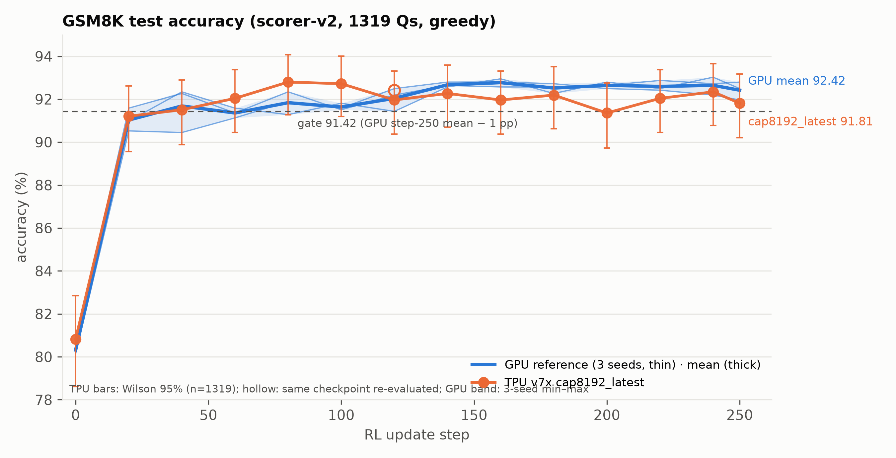

# gemma4-E2B GSM8K RL: GPU ↔ TPU accuracy parity at response cap 8192 (latest image, all fixes)

**Result: parity PASS (run `g4lp8k`, 2026-10-30).** Step-250 GSM8K accuracy **91.81 %** on TPU vs the GPU 3-seed
mean **92.42 ± 0.42 %** (gate ≥ 91.42 %, margin +0.39 pp). 12 of 14 eval points within ±1 pp of the GPU mean, all
14 within the single-run Wilson 95 % half-width (±1.4 pp). Rollouts are not truncated on either side, so this is
the like-for-like check against the GPU recipe. Full configuration:
[`parity/configs/g4lp8k_cap8192_parity_full_config.md`](parity/configs/g4lp8k_cap8192_parity_full_config.md);
manifest: [`parity/manifests/g4lp8k-latest-image-cap8192-seed42-parity-250.yaml`](parity/manifests/g4lp8k-latest-image-cap8192-seed42-parity-250.yaml).

## 1. Standard

| element | definition |
|---|---|
| metric | scorer-v2 accuracy on the GSM8K test split (1319 questions), greedy decode (`eval_temperature=0.01`, `top_k=1`, stop ids `[1, 106, 50]`): last `\boxed{…}` equals the gold. Same scorer file on both platforms (`boxed_math_reward_v2.compute_score`, hash-verified) |
| reference | frozen GPU runs `gemma4_e2b_gsm8k8k_16n64g_s250_seed{1,2,3}` (verl + vLLM, 64 GPUs, `max_response_length=8192`, `max_prompt_length=512`); step-250 mean 92.42 %, SD 0.42, seeds 91.96 / 92.49 / 92.80 |
| gate | TPU step-250 accuracy ≥ GPU mean − 1 pp = 91.42 % |
| curve | every eval point (0, 20, …, 240, 250) within ±1 pp of the GPU mean, judged against the Wilson 95 % half-width |
| not the metric | MaxText's lenient eval `accuracy` (89.08 % at step 250) |

## 2. Configuration (saved in full in `parity/configs/`)

Identical to the GPU recipe: `google/gemma-4-E2B-it` (converted checkpoint `gemma4-e2b-it-fresh`) · GSM8K train,
shuffle seed 42 · native `<|turn>` template, one `<bos>`, same system prompt · GRPO 128 prompts × 16 samples,
T = 1.0, top_p 1.0, top_k −1 · advantage `(R − mean)/(std + 1e-6)` · loss `−A·w·logπθ`, token-mean, no clip / KL /
entropy · token-level truncated importance sampling `w = min(exp(clamp(Δlogπ, −20, 20)), 3)` · LR 2e-6, 10 warm-up
updates, cosine to 0 at 250 · AdamW (0.9, 0.999), eps 1e-8, wd 0, grad clip 1.0 · fp32 master and Adam, bf16 compute
and rollout · **prompt 512 / response cap 8192** · 250 updates · eval every 20 updates and at 250.

| group | setting |
|---|---|
| image | `maxtext-rl-ironwood@sha256:4dc6ca72…` (2026-09-22-head: jax 0.11.0, libtpu 0.0.44, vLLM 0.28.1rc1, transformers 5.12.1); Pathways `20261028-jax_0.11.0` |
| slice | tpu7x 4x4x4 (64 chips), trainer and sampler share the slice (`trainer_devices_fraction=sampler_devices_fraction=1.0`), `rollout_data_parallelism=128`, `rollout_tensor_parallelism=1` |
| lengths | `max_prefill_predict_length=512`, `max_target_length=8704`, `kv_cache_buffer=8704` (response cap 8192) |
| batch | `batch_size=128`, `rl.num_generations=16`, `train_micro_batch_size=8`, `rollout_micro_batch_size=128` |
| sampling | `decode_sampling_temperature=1.0`, `decode_sampling_top_k=-1`, `decode_sampling_nucleus_p=1.0` |
| optimizer | `learning_rate=2e-6`, `lr_schedule_type=cosine`, `warmup_steps_fraction=0.04`, `learning_rate_final_fraction=0.0`, `adam_eps=1e-8`, `adam_weight_decay=0.0`, `gradient_clipping_threshold=1.0`, `weight_dtype=mu_dtype=float32` |
| GRPO | `rl.grpo_beta=0.0`, `rl.grpo_epsilon=0.2`, `rl.epsilon_high=0.28`, `rl.loss_agg_mode=token-mean`; sampler IS `PARITY_SAMPLER_IS=token`, threshold 3.0 |
| reward / eval | `reward_functions_path=reward_parity_boxed.py` (`compute_score`, scorer v2), `eval_interval=20`, `eval_sampling_strategy=greedy`, `eval_batch_size=128`, `num_test_batches=11` (full 1319) |
| rollout engine | vLLM continue-decode (`enable_continue_decode`, `max_decode_steps=1024`), `CONTINUE_DECODE_EOS_CHECK_INTERVAL=32`, `DP_SCHED_ROUTING=round_robin`, `APPROX_TOPK=1`, `vllm_block_size=128`, `free_kv_cache_during_weight_sync=false`, `hbm_utilization_vllm=0.3`, `max_num_seqs=256`, `max_num_batched_tokens=33280`, `EXTRA_STOP_TOKEN_IDS=[106,50]` |
| attention | `attention=flash`, explicit `local_sa_*` / `eval_local_sa_*` blocks 512, `HEAD_DIM_MINOR`, `scan_layers=False` |
| checkpoints | `checkpoint_period=20`, `checkpoint_storage_use_ocdbt=False`, resume across the 120-minute admission limit (`parity/tools/chain-seeds4.sh`) |
| power | `--xla_tpu_dvfs_p_state=6` throughout (full XLA flag list in the config file) |
| seeds | `data_shuffle_seed=42`, `init_weights_seed=42` |

Fixes in effect, and where they live now:

| fix | in this run | now |
|---|---|---|
| KV-sharing write-back (gemma4 rollouts were gibberish without it) | `patch_kv_alias_dedupe` / `patch_newimg_fix` | MaxText PR [#6081](https://github.com/AI-Hypercomputer/maxtext/pull/6081) (same effect; validated 0.00 % → 80.82 % at step 0) |
| reward-regex catastrophic backtracking | `patch_g4_format_guard` | MaxText PR [#6082](https://github.com/AI-Hypercomputer/maxtext/pull/6082) |
| local splash-attention settings missing in the RL config on the new image | explicit `local_sa_*` arguments | configuration (kept) |
| GPU-matching sampler IS, scorer v2, eval coverage, native template, resumable checkpoints | `patch_sampler_is`, `reward_parity_boxed.py`, `gemma_data_parity_native.py` | parity recipe files, unchanged |
| the remaining 28 runtime patches (perf, logging) | applied | audited on 2026-11-02 against the same image: no effect on speed or rollouts (byte-identical), retired from the recipe; see [`GEMMA4_E2B_PATCH_AUDIT_LATEST_IMAGE.md`](GEMMA4_E2B_PATCH_AUDIT_LATEST_IMAGE.md) |

## 3. Results

### 3.1 Accuracy (scorer v2, 1319 questions)

| step | GPU mean ± SD | TPU cap 8192 | Δ |
|---:|---|---|---:|
| 0 | 80.31 ± 0.24 | 80.82 | +0.51 |
| 20 | 91.03 ± 0.53 | 91.21 | +0.18 |
| 40 | 91.69 ± 1.07 | 91.51 | −0.18 |
| 60 | 91.36 ± 0.23 | 92.04 | +0.68 |
| 80 | 91.84 ± 0.53 | 92.80 | +0.96 |
| 100 | 91.64 ± 0.16 | 92.72 | +1.08 |
| 120 | 92.04 ± 0.55 | 91.96 | −0.08 |
| 140 | 92.67 ± 0.12 | 92.27 | −0.40 |
| 160 | 92.77 ± 0.19 | 91.96 | −0.81 |
| 180 | 92.52 ± 0.23 | 92.19 | −0.33 |
| 200 | 92.65 ± 0.15 | 91.36 | −1.29 |
| 220 | 92.60 ± 0.24 | 92.04 | −0.56 |
| 240 | 92.65 ± 0.42 | 92.34 | −0.31 |
| **250** | **92.42 ± 0.42** | **91.81** | **−0.61** |

Gate 91.81 ≥ 91.42: **PASS**. Mean deviation over 14 points −0.08 pp, sign changes 5 times (no systematic offset);
the two out-of-band points (+1.08 at 100, −1.29 at 200) are inside the Wilson width and followed by in-band points.

### 3.2 Dynamics

| quantity | GPU | TPU |
|---|---|---|
| boxed rate step 0 → 20 | 87.95 % → 100 % | 87.72 % → 100 % |
| wrong→right / right→wrong at 250 vs step 0 | 176–183 / 14–22 | 173 / 28 |
| k3 KL per update (median) | 3.4e-4 – 5.0e-4 | 4.1e-4 (p90 4.6e-4) |
| ESS per update | ≥ 0.999 | mean 0.9992, min 0.9989 |
| clipped IS fraction | 3.7e-6 | 8e-7 |
| rollout mean length (tokens), update 1 → 250 | 480 → 610 | 443 → 626 |
| truncation at the cap | 1 update of 250 with clip_ratio > 0 | 1 rollout in 601 logged updates |
| wall time per update, median | 31.7 / 33.1 / 35.0 s (64 GPUs) | 49.4 s |

Known benign difference: the per-update maximum IS weight reaches the cap 3.0 on TPU (bf16 sampler vs fp32 trainer;
mean weight 1.000, clipped fraction below the GPU's).



## 4. Evidence

* Key log lines: [`parity/logs/latest_image/g4lp8k_cap8192_parity_key_lines.log`](parity/logs/latest_image/g4lp8k_cap8192_parity_key_lines.log); step times: [`parity/logs/latest_image/g4lp8k_cap8192_steptimes_all.txt`](parity/logs/latest_image/g4lp8k_cap8192_steptimes_all.txt)
* Per-question eval dumps: [`parity/evals_cap8192/`](parity/evals_cap8192/) (`gs://ubench-logs/g4lp8k/evals/`)
* Figures and summary table: [`parity/figures_cap8192/`](parity/figures_cap8192/)
* GPU recipe settings: [`parity/logs/gpu_reference_verl_config.txt`](parity/logs/gpu_reference_verl_config.txt)

Admissions: 1–121 (fresh), resume from checkpoint 120 after the 120-minute limit, JobSet restart at update 193 and
resume from checkpoint 180; restart evals agree with the pre-pause evals to within 0.46 pp.

## 5. Reproduce

```
bash parity/tools/apply-jobset.sh parity/manifests/g4lp8k-latest-image-cap8192-seed42-parity-250.yaml
NAMES="g4lp8k" bash parity/tools/chain-seeds4.sh      # resumes across the 120-minute admission limit
```

Rebuild the manifest: `CAP=8192 FIX=patches/patch_kv_alias_dedupe.py STEPS=250 python3 parity/build_g4l24.py`.
Figures: `python3 parity/tools/make_parity_figures.py --gpu <aggregate_summary.json> --tpu "cap8192_latest=parity/evals_cap8192:<log>" --out figs --dpi 300`.
