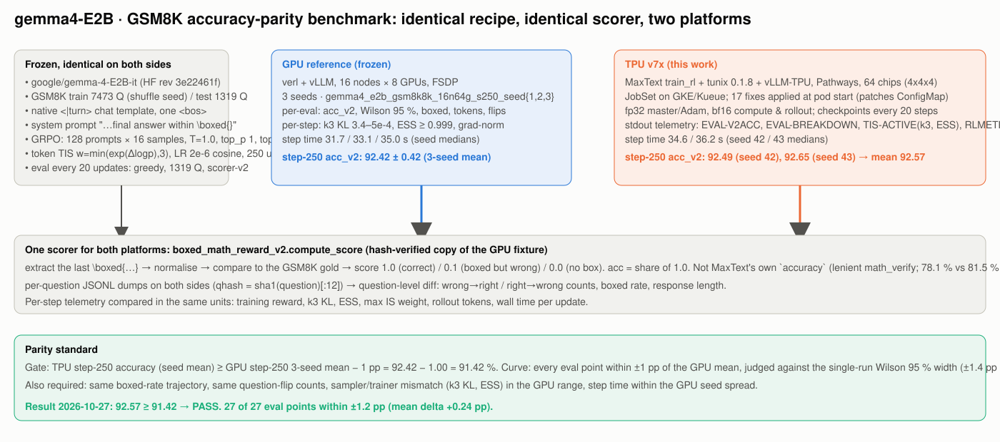
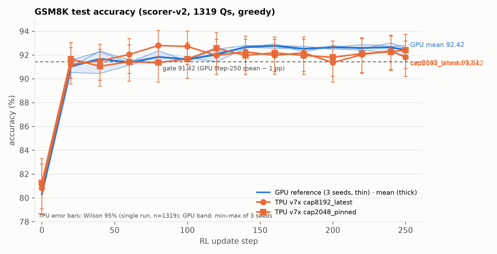
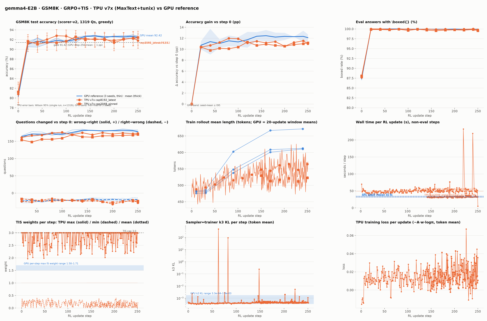

# gemma4-E2B GSM8K RL: GPU ↔ TPU accuracy-parity check of the **GPU-matching recipe** (latest image, response cap 8192, p-state 6)

**Result (2026-10-30): parity reached.** The TPU recipe that matches the GPU reference's response cap
(`max_response_length=8192`) reproduces the frozen GPU reference curve: step-250 accuracy **91.81 %** vs the
GPU 3-seed mean **92.42 ± 0.42 %** (gate ≥ 91.42 % **passed**, margin +0.39 pp); 12 of 14 eval points within
±1 pp of the GPU mean, all 14 within the single-run Wilson 95 % half-width (±1.4 pp). Same standard, same
benchmark method and the same nine comparison items as the 35 s and 24 s checks
([`GEMMA4_E2B_GPU_TPU_PARITY_REPORT.md`](GEMMA4_E2B_GPU_TPU_PARITY_REPORT.md),
[`GEMMA4_E2B_24S_CONFIG_PARITY_REPORT.md`](GEMMA4_E2B_24S_CONFIG_PARITY_REPORT.md)). This is the first TPU check
that is like for like with the GPU recipe: no rollout is truncated on either side.



---

## 1. The standard for accuracy parity (unchanged)

| element | definition |
|---|---|
| **Metric** | scorer-v2 accuracy on the GSM8K **test** split (1319 questions), greedy decode (`eval_temperature=0.01, top_k=1`, stop ids `[1, 106, 50]`): `acc = share of answers whose last \boxed{…} equals the gold`. Identical scorer file on both platforms (`boxed_math_reward_v2.compute_score`, hash-verified against the GPU fixture). |
| **Reference** | the frozen GPU runs `gemma4_e2b_gsm8k8k_16n64g_s250_seed{1,2,3}` (verl + vLLM, 16 × 8 GPUs, FSDP, `max_response_length=8192`, `max_prompt_length=512`): per-eval `acc_v2` with Wilson 95 % intervals, boxed rate, response tokens, question flips; per-step k3 KL, ESS, IS-weight max; per-seed step time. 3-seed step-250 mean 92.42 %, SD 0.42, seeds 91.96 / 92.49 / 92.80. |
| **Gate** | fixed-step-250 V2 accuracy: **TPU ≥ GPU mean − 1 pp = 91.42 %** (absolute, at step 250, not the best step). |
| **Curve** | every TPU eval point (0, 20, …, 240, 250) within **±1 pp of the GPU mean**, judged against the single-run Wilson 95 % half-width (±1.4 pp at n = 1319) and the GPU seed spread. |
| **Dynamics** | boxed-rate trajectory, wrong→right / right→wrong counts vs step 0, training reward per update, sampler↔trainer k3 KL and ESS, rollout length and wall time per update, compared in the same units. |
| **Not the metric** | MaxText's own eval `accuracy` (lenient `check_correctness` + `math_verify`, 89.08 % at step 250 here) is ignored. |

## 2. How the accuracy is benchmarked

**What is identical to the GPU recipe (audited, and now including the cap):** `google/gemma-4-E2B-it`
(HF rev 3e22461f, converted checkpoint `gemma4-e2b-it-fresh`) · GSM8K train, shuffle seed 42 · native `<|turn>`
template, one `<bos>`, the same system prompt · GRPO 128 prompts × 16 samples, T = 1.0, top_p 1.0, top_k −1 ·
advantage `(R − mean)/(std + 1e-6)` · loss `−A·w·logπθ`, token-mean, no clip / KL / entropy · token-level
truncated IS `w = min(exp(clamp(logπθ − logπsampler, −20, 20)), 3)` · LR 2e-6, 10 warm-up, cosine to 0 at 250 ·
AdamW (0.9, 0.999), eps 1e-8, wd 0, clip 1.0 · fp32 master + fp32 Adam, bf16 compute and rollout ·
**prompt 512 / response cap 8192** (`max_target_length=8704`) · 250 updates · eval every 20 updates + at the end.

**What differs from the earlier TPU checks:**

| item | 35 s recipe (seeds 42/43/44) | 24 s configuration | **this check** |
|---|---|---|---|
| image | pinned `f7c957d0…` | pinned | **latest `2026-09-22-head` (`4dc6ca72…`)**: jax 0.11.0, libtpu 0.0.44, vLLM 0.28.1rc1, transformers 5.12.1; Pathways `20261028-jax_0.11.0` |
| response cap | 2560 | 2048 | **8192 (= GPU)** |
| truncated rollouts per update | ≤ 0.9 % | 0.05–2.2 % | **0 % (one rollout in 601 logged updates)** |
| DVFS | p-state 7 | 7 → 6 at update 141 | **p-state 6 throughout** |
| perf levers | none | cap 2048, async reward, round-robin routing, approx-max-k, EOS interval 32 | same levers as the 24 s configuration, native where the image provides them |
| image-specific fixes | — | — | KV-cache alias dedupe (`patch_kv_alias_dedupe.py`), explicit `local_sa_*` splash settings |

Everything in the GPU recipe that the earlier checks approximated (the response cap) is now matched; the GPU's
overlong-penalty reward term (512-token buffer below the cap) is the one remaining recipe difference, and it
never fires on either side at these lengths.

**TPU stack:** MaxText `train_rl` + tunix + vLLM-TPU rollout under Pathways, one tpu7x 4x4x4 slice (64 chips),
JobSet applied with an ownerReference (`parity/tools/apply-jobset.sh`); manifest
[`parity/manifests/g4lp8k-latest-image-cap8192-seed42-parity-250.yaml`](parity/manifests/g4lp8k-latest-image-cap8192-seed42-parity-250.yaml)
built by `parity/build_g4l24.py` (`CAP=8192 FIX=patches/patch_kv_alias_dedupe.py STEPS=250`).

**Instrumentation and procedure:** the same head-pod stdout lines as the earlier checks (`EVAL-BREAKDOWN` /
`EVAL-V2ACC` with per-question JSONL dumps, `TIS-ACTIVE`, `RLMETRIC`, `REWARD-DEBUG`, `LENDIST`, `PHASETIME`,
checkpoint restore lines); `parity/tools/chain-seeds4.sh` handled the cluster's 120-minute per-admission limit
(three admissions: deactivation at update 121 → resume from checkpoint 120; a JobSet-level restart at update 193
after a worker-pod restart → resume from checkpoint 180); figures and tables from
`parity/tools/make_parity_figures.py` against the GPU `aggregate_summary.json`, with the 24 s-configuration run
as overlay.

## 3. Results and evidence

### 3.1 Accuracy curve (scorer-v2, 1319 Qs)

| step | GPU mean ± SD (min–max) | TPU cap 8192 [Wilson 95 %] | Δ vs GPU mean | TPU cap 2048, pinned image (overlay) |
|---:|---|---|---:|---|
| 0 | 80.31 ± 0.24 (80.14–80.59) | 80.82 [78.6, 82.9] | +0.51 | 81.27 |
| 20 | 91.03 ± 0.53 (90.52–91.58) | 91.21 [89.6, 92.6] | +0.18 | 91.66 |
| 40 | 91.69 ± 1.07 (90.45–92.34) | 91.51 [89.9, 92.9] | −0.18 | 91.05 |
| 60 | 91.36 ± 0.23 (91.13–91.58) | 92.04 [90.5, 93.4] | +0.68 | 91.43 |
| 80 | 91.84 ± 0.53 (91.28–92.34) | 92.80 [91.3, 94.1] | +0.96 | 91.36 |
| 100 | 91.64 ± 0.16 (91.51–91.81) | 92.72 [91.2, 94.0] | +1.08 | 91.66 |
| 120 | 92.04 ± 0.55 (91.43–92.49) | 91.96 [90.4, 93.3] (restart eval on the restored step-120 weights; 92.42 at 121 before the pause) | −0.08 | 92.57 |
| 140 | 92.67 ± 0.12 (92.57–92.80) | 92.27 [90.7, 93.6] | −0.40 | 91.96 |
| 160 | 92.77 ± 0.19 (92.57–92.95) | 91.96 [90.4, 93.3] | −0.81 | 92.19 |
| 180 | 92.52 ± 0.23 (92.27–92.72) | 92.19 [90.6, 93.5] (restart eval; 91.74 before the restart) | −0.33 | 91.96 |
| 200 | 92.65 ± 0.15 (92.49–92.80) | 91.36 [89.7, 92.8] | −1.29 | 91.81 |
| 220 | 92.60 ± 0.24 (92.42–92.87) | 92.04 [90.5, 93.4] | −0.56 | 92.12 |
| 240 | 92.65 ± 0.42 (92.19–93.03) | 92.34 [90.8, 93.7] | −0.31 | 92.27 |
| **250** | **92.42 ± 0.42 (91.96–92.80)** | **91.81** [90.2, 93.2] | **−0.61** | 92.42 |

**Gate:** 91.81 ≥ 91.42 → **PASS.** The final point is 0.61 pp below the GPU 3-seed mean and 0.15 pp below the
lowest GPU seed, inside the Wilson half-width. 12 of 14 points within ±1 pp; the two exceptions (+1.08 at step
100, −1.29 at step 200) are within the Wilson width and are each followed by in-band points; the mean deviation
over the 14 points is −0.08 pp and the sign changes 5 times, i.e. no systematic offset. The step-200 dip
(91.36) is the same transient seen in seed 44 of the 35 s recipe (91.58 at step 200) and recovers by 220. The two
restart evals (120 and 180) agree with the pre-pause evals on the same or adjacent weights to within 0.46 pp.

### 3.2 Dynamics

| quantity | GPU | TPU cap 8192 (this check) | TPU cap 2048, pinned (overlay) |
|---|---|---|---|
| boxed rate step 0 → 20 | 87.95 % → 100 % | 87.72 % → 100 % (99.8–100 % thereafter) | 88.10 % → 99.85 % |
| wrong→right / right→wrong at 250 (vs step 0) | 176–183 / 14–22 | 173 / 28 | 170 / 23 |
| training reward (mean score per update) | train_acc_v2 84.5 % → 92.1 % | 0.70 (update 1) → 0.93 (update 250), median 0.931, max 0.967 | 0.92 → 0.93 (logged segment) |
| k3 KL per update | 3.4e-4 – 5.0e-4 | median 4.1e-4, p90 4.6e-4; 3 updates carry a single-token outlier (max 4.8e+2) | 3.8e-4 – 2.0e-3 |
| ESS per update | ≥ 0.999 | mean 0.9992, min 0.9989 (also on the outlier updates) | ≥ 0.9986 |
| clipped IS fraction | 3.7e-6 | 8e-7 | 4.2e-6 |
| per-update max IS weight | 1.50 – 1.71 | 1.97 – 3.0 (cap) | 2.63 – 3.0 (cap) |
| rollout mean length (tokens) | 480 → 610 | **443 → 626** (same growth as GPU) | 480 → 527 (cap-limited tail) |
| truncation at the cap | 1 update of 250 with clip_ratio > 0 | 1 rollout (update 159) in 601 logged updates | 0.05–2.2 % per update |
| wall time per update (median, non-eval) | 31.7 / 33.1 / 35.0 s | **49.4 s** whole run (46.4 s over updates 2–19) | 32.1 s |

The known benign difference remains: the TPU's per-update *maximum* importance weight reaches the cap 3.0
(bf16 vLLM sampler vs fp32-master trainer; mean weight 1.000, clipped fraction below the GPU's), and three
updates carry one token each with a huge log-ratio that drives the k3 mean while ESS stays above 0.9989. New
in this check: the rollout-length trajectory now matches the GPU's (growth to ~620 tokens), which the capped
recipes could not reproduce, and truncation is zero on both sides.

### 3.3 Figures

High-resolution (300 dpi): [`parity/figures_cap8192/hires/`](parity/figures_cap8192/hires/); summary table
[`parity/figures_cap8192/parity_summary.md`](parity/figures_cap8192/parity_summary.md).


*Accuracy vs update. Blue: GPU seeds (thin), mean (thick), min–max band. Orange: TPU cap 8192 on the latest image (circles) and the cap-2048 pinned-image run (squares) with Wilson 95 % bars. Dashed: the 91.42 gate.*


*All nine panels: accuracy, gain vs step 0, boxed rate, question flips, rollout length, wall time, TIS weights, k3 KL, loss. The cap-8192 dynamics panels cover all three admissions (updates 1–120, 121–193, 181–250).*

### 3.4 Log evidence

Full extracts: [`parity/logs/latest_image/g4lp8k_cap8192_parity_key_lines.log`](parity/logs/latest_image/g4lp8k_cap8192_parity_key_lines.log);
step times [`parity/logs/latest_image/g4lp8k_cap8192_steptimes_all.txt`](parity/logs/latest_image/g4lp8k_cap8192_steptimes_all.txt);
per-question dumps [`parity/evals_cap8192/`](parity/evals_cap8192/) (`gs://ubench-logs/g4lp8k/evals/`);
GPU recipe settings [`parity/logs/gpu_reference_verl_config.txt`](parity/logs/gpu_reference_verl_config.txt).

Patches applied at pod start, and what the scorer sees:

```
TIS-PARITY PATCH: APPLIED (train_rl: sampler_is=token thr=3.0, return_logprobs=True, eval full-coverage drop_remainder=False, rollout bf16, RLMETRIC stdout mirror; grpo_learner TIS-ACTIVE(+k3/ess) stdout; evaluate_rl EVAL-V2ACC step-named dumps; checkpoint_manager RNG-free resumable ckpt; rl_learner resume-sync; max_steps=num_batches)
KV-ALIAS-DEDUPE: APPLIED /deps/src/maxtext/integration/vllm/hybrid_cache_utils.py
REWARD-DEBUG n=1 answer_type=list gold0=np.str_('["300"]') gold_str0='300' n_correct=1 n_boxed_wrong=0 n_zero=0 tail0=' … $$\\boxed{300}$$<turn|>'
```

Eval lines across the three admissions (UTC; periodic evals land at 20k+1 on a fresh start and at 20k−1 after a
resume at S+1; restart evals at the exact checkpoint step):

```
[08:14] admission 1   EVAL-BREAKDOWN step=0   acc=80.82% boxed_wrong=6.90% nobox=12.28% mean_chars=1424
                      step=21 acc=91.21%  step=41 acc=91.51%  step=61 acc=92.04%  step=81 acc=92.80%  step=101 acc=92.72%  step=121 acc=92.42%
[10:14] 120-min deactivation → RESUME (ckpt 120): Found 6 checkpoint steps / Restored params from step: 120 in 14.663 seconds / RESUME-SYNC (global_steps=120)
[10:21] admission 2   EVAL-BREAKDOWN step=120 acc=91.96% (restart eval)   step=140 acc=92.27%   step=160 acc=91.96%   step=180 acc=91.74%
[11:40] JobSet restart at update 193 (worker pod restarted): Found 9 checkpoint steps / Restored params from step: 180 in 13.276 seconds / RESUME-SYNC (global_steps=181)
[11:47] admission 2b  EVAL-BREAKDOWN step=180 acc=92.19% (restart eval)   step=199 acc=91.36%   step=219 acc=92.04%   step=239 acc=92.34%
[13:03]               EVAL-BREAKDOWN step=250 k=4 total=1319 acc=91.81% boxed_wrong=7.96% nobox=0.23% mean_chars=1679
                      EVAL-V2ACC total=1319 v2_acc=91.8120% mean_reward=0.9261
                      Post RL Training: corr=1175, total=1319, accuracy=89.08%, partial_accuracy=89.99%, mean_reward=0.9261   (MaxText's lenient metric, not the parity metric)
                      EXIT_CODE=0
```

Sampler↔trainer mismatch (first update, on-policy) and rollout length / truncation / phase timing at the end:

```
TIS-ACTIVE weight_mean=0.99993 weight_min=0.10267 weight_max=2.18695 frac_clipped=0.000000 k3_kl=4.4013e-04 ess=0.999152 logratio_mean=-4.8987e-04 logratio_absmean=8.1243e-03 ntok=1140283
TIS summary over 265 logged updates: k3 median 4.1e-4 (p90 4.6e-4), ESS mean 0.9992 (min 0.9989), frac_clipped 8e-7
LENDIST step=250 n=2048 cap=8192 truncated=0 (0.00%) eos_at_cap=0 osl_mean=541.3 isl_mean=93.8
PHASETIME step=10  compute_rewards=0.08 engine_generate=33.85 generate_and_advantage=37.06 micro_batch_steps=49.84 run_global_step=49.84
PHASETIME step=249 compute_rewards=0.08 engine_generate=37.81 generate_and_advantage=40.98 micro_batch_steps=53.22 run_global_step=53.22
```

## 4. What we fixed to get here

The run inherits the 17 parity fixes of the 35 s check and the 4 of the 24 s configuration. Specific to this
recipe (details in [`GEMMA4_E2B_LATEST_IMAGE_STATUS.md`](GEMMA4_E2B_LATEST_IMAGE_STATUS.md) and
[`GEMMA4_E2B_OPTIMIZATION_REPORT_CAP8192.md`](GEMMA4_E2B_OPTIMIZATION_REPORT_CAP8192.md)):

| # | symptom | root cause | fix |
|---|---|---|---|
| 1 | rollouts were gibberish on the latest image (0 % accuracy, identical across weight-sync variants) | the new MaxText-in-vLLM adapter expanded the per-layer KV-cache map to 35 entries for gemma4-E2B's 15 physical caches and scattered the 20 stale alias entries back over the donors' updates | `patch_kv_alias_dedupe.py`: present each physical cache once, in first-use layer order |
| 2 | first training step crashed in `create_sa_config` (`'<' … 'int' and 'NoneType'`) | the new `attention_op` reads the local-attention splash fields directly; the RL config leaves them `None` | explicit `local_sa_*` / `eval_local_sa_*` settings (512, `HEAD_DIM_MINOR`) |
| 3 | `kubectl apply` of the JobSet rejected or silently stripped | a kyverno policy added 2026-10-29 mutates ownerless JobSets and replaces `spec.replicatedJobs` | create the JobSet with an ownerReference to its launcher ConfigMap (`tools/apply-jobset.sh`); chain re-based (`chain-seeds4.sh`) |
| 4 | post-resume periodic evals landed at 199/219/239 and were not matched to the GPU grid | eval counter restarts from the resume step | figure tool snaps steps within ±2 of the 20-step grid |
| 5 | the recipe truncated rollouts the GPU did not | cap 2048/2560 vs GPU 8192 | cap 8192 (`max_target_length=8704`, `kv_cache_buffer=8704`, splash blocks 512); 13 of the 36 perf patches retired as native on this image |

## 5. Reproduce

* Manifest: [`parity/manifests/g4lp8k-latest-image-cap8192-seed42-parity-250.yaml`](parity/manifests/g4lp8k-latest-image-cap8192-seed42-parity-250.yaml); apply with
  `bash parity/tools/apply-jobset.sh <manifest>`; resume across the 120-minute limit with `NAMES="g4lp8k" bash parity/tools/chain-seeds4.sh`.
* Rebuild: `CAP=8192 FIX=patches/patch_kv_alias_dedupe.py STEPS=250 python3 parity/build_g4l24.py` (the 20-update perf variant: `STEPS=20 CLEAN=1`).
* Figures/tables: `python3 parity/tools/make_parity_figures.py --gpu <aggregate_summary.json> --tpu "cap8192_latest=parity/evals_cap8192:<log>" "cap2048_pinned=parity/evals_24s_config:<log>" --out figs --dpi 300`.
