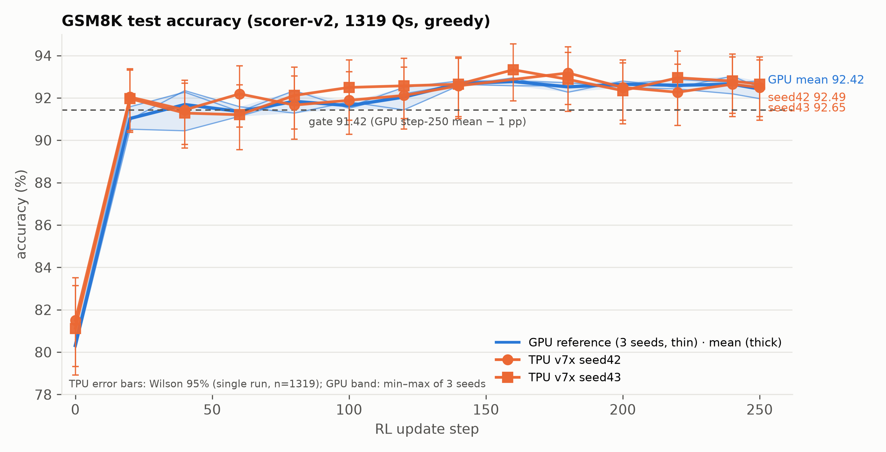
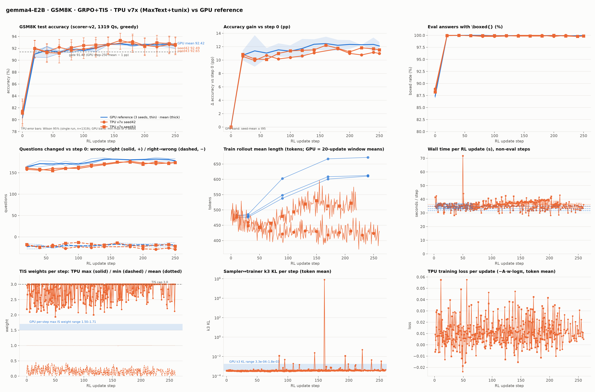

# gemma4-E2B GSM8K RL: GPU ↔ TPU accuracy-parity check

**Result (2026-10-29): parity reached.** TPU v7x reproduces the frozen GPU reference curve on two
seeds; step-250 accuracy 92.49 % and 92.65 % (mean **92.57 %**) vs the GPU 3-seed mean
**92.42 ± 0.42 %**; gate ≥ 91.42 % **passed**; 27 of 27 eval points within ±1.2 pp. Seed 44 is running
for the 3-seed mean. The optimized 24 s recipe re-ran at 23.9 s/step with its reward inside the GPU band.


---

## 1. The standard for accuracy parity

| element | definition |
|---|---|
| **Metric** | scorer-v2 accuracy on the GSM8K **test** split (1319 questions), greedy decode (`eval_temperature=0.01, top_k=1`, stop ids `[1, 106, 50]`): `acc = share of answers whose last `\boxed{…}` equals the gold`. Identical scorer file on both platforms (`boxed_math_reward_v2.compute_score`, hash-verified against the GPU fixture). |
| **Reference** | the frozen GPU runs `gemma4_e2b_gsm8k8k_16n64g_s250_seed{1,2,3}` (verl + vLLM, 16 × 8 GPUs, FSDP): per-eval `acc_v2` with Wilson 95 % intervals, boxed rate, response tokens, question flips; per-step k3 KL, ESS, IS-weight max, grad-norm; per-seed step time. 3-seed step-250 mean 92.42 %, SD 0.42, seeds 91.96 / 92.49 / 92.80. |
| **Gate** | fixed-step-250, seed-mean, V2 accuracy: **TPU mean ≥ GPU mean − 1 pp = 91.42 %**. 1 pp is absolute, not relative, and the step is fixed at 250 (not the best step). |
| **Curve** | every TPU eval point (0, 20, …, 240, 250) within **±1 pp of the GPU mean**, judged against the single-run Wilson 95 % half-width (±1.4 pp at n = 1319) and the GPU seed spread. |
| **Dynamics** | boxed-rate trajectory, wrong→right / right→wrong counts vs step 0, training reward per update, sampler↔trainer k3 KL and ESS, rollout length and wall time per update all compared in the same units. A matching endpoint with different dynamics would not count. |
| **Not the metric** | MaxText's own eval `accuracy` (its `check_correctness` with `math_verify`) is lenient and reads 3–4 pp lower; it was the source of an apparent gap and is ignored. |

## 2. How the accuracy is benchmarked

**Identical recipe on both sides (audited line by line):** `google/gemma-4-E2B-it` (HF rev 3e22461f;
pod-cached tokenizer / chat template / generation config hash-match the GPU fixture) · GSM8K train
(7473 Q, shuffle seed = run seed) · native `<|turn>` template via `apply_chat_template`, exactly one
`<bos>` · system prompt *"You are a helpful assistant. Please reason step by step, and put your final
answer within \boxed{}."* · GRPO, 128 prompts × 16 samples, T = 1.0, top_p 1.0, top_k −1 (explicit,
overriding vLLM's generation-config defaults), advantage `(R − mean)/(std + 1e-6)`, groups with zero
variance kept · loss `−A·w·logπθ`, token-mean, no PPO clip / KL / entropy · token-level truncated IS
`w = min(exp(clamp(logπθ − logπsampler, −20, 20)), 3)` · LR 2e-6, 10 warm-up steps, cosine to 0 at
250 · AdamW β (0.9, 0.999), eps 1e-8, wd 0, clip 1.0 · fp32 master + fp32 Adam, bf16 compute and
rollout · 250 updates · eval every 20 updates + at the end.

**TPU stack:** MaxText `train_rl` + tunix 0.1.8 (pinned image digest `f7c957d0…`) + vLLM-TPU
rollout, Pathways, one tpu7x 4x4x4 slice (64 chips) as a Kueue JobSet. Every TPU-side correction is
a self-applying patch in the manifest's ConfigMap; the 17 fixes and their evidence are in
[`GEMMA4_E2B_GSM8K_ACCURACY_PARITY.md`](GEMMA4_E2B_GSM8K_ACCURACY_PARITY.md). The ones that changed
the science: TIS actually active (config-only on tunix 0.1.8), eval over all 1319 questions, scorer-v2
accuracy logged (`EVAL-V2ACC`), and the **training reward fix** (tunix passes golds as a numpy
array; the old helper scored every boxed answer 0.1, so earlier TPU runs learned only the format).

**Instrumentation (stdout of the head pod, mirrored to GCS):**

| line | what it carries |
|---|---|
| `EVAL-BREAKDOWN step=… acc=… boxed_wrong=… nobox=… mean_chars=… dump=gs://…/evals/eval_<step>.jsonl` | the parity metric per eval + a per-question JSONL (`i, qhash, gold, boxed, score, acc, fmt, n_chars, tail`) |
| `EVAL-V2ACC total=1319 v2_acc=… mean_reward=…` | scorer-v2 accuracy and mean score (acc ≤ mean ≤ acc + 0.1·boxed_wrong) |
| `TIS-ACTIVE weight_mean/min/max frac_clipped k3_kl ess logratio_mean/absmean ntok` | sampler↔trainer mismatch per update, same definitions as the GPU's `k3_kl` and `ess` |
| `RLMETRIC 'rewards' 'mean' …`, `'actor' 'learning_rate' …`, loss/entropy/pg_clipfrac | every tensorboard scalar mirrored to stdout |
| `REWARD-DEBUG n=… gold0=… gold_str0=… n_correct=…` | one-time proof of what the training scorer sees |
| `LENDIST step=… cap=… truncated=… osl_mean=…`, `PHASETIME step=… engine_generate=… run_global_step=…` | rollout length / truncation and phase timings per update |
| `Found N checkpoint steps`, `Restored params from step: S`, `RESUME-SYNC …` | checkpoint resume path (every 20 steps; the cluster deactivates workloads after 120 min) |

**Procedure:** build the manifest (`parity/build_g4pt.py <seed-index>`, `CKPT=1`), apply it
(`parity/manifests/`), let `parity/tools/chain-seeds3.sh` handle the 2-hour-limit resumes, collect
`evals/eval_*.jsonl` from `gs://ubench-logs/<run>/`, and run `parity/tools/make_parity_figures.py`
against the GPU `aggregate_summary.json`, which produces the tables and figures below and the gate verdict.

## 3. Results and evidence

### 3.1 Accuracy curve (scorer-v2, 1319 Qs)

| step | GPU mean ± SD (min–max) | TPU seed 42 [Wilson 95 %] | TPU seed 43 [Wilson 95 %] | TPU mean − GPU |
|---:|---|---|---|---:|
| 0 | 80.31 ± 0.24 (80.14–80.59) | 81.50 [79.3, 83.5] | 81.12 [78.9, 83.1] | +1.00 |
| 20 | 91.03 ± 0.53 (90.52–91.58) | 92.04 [90.5, 93.4] | 91.96 [90.4, 93.3] | +0.97 |
| 40 | 91.69 ± 1.07 (90.45–92.34) | 91.43 [89.8, 92.8] | 91.28 [89.7, 92.7] | −0.33 |
| 60 | 91.36 ± 0.23 (91.13–91.58) | 92.19 [90.6, 93.5] | 91.21 [89.6, 92.6] | +0.34 |
| 80 | 91.84 ± 0.53 (91.28–92.34) | 91.66 [90.0, 93.0] | 92.12 [90.5, 93.5] | +0.05 |
| 100 | 91.64 ± 0.16 (91.51–91.81) | 91.89 [90.3, 93.2] | 92.49 [90.9, 93.8] | +0.56 |
| 120 | 92.04 ± 0.55 (91.43–92.49) | 92.12 [90.5, 93.5] | 92.57 [91.0, 93.9] | +0.31 |
| 140 | 92.67 ± 0.12 (92.57–92.80) | 92.57 [91.0, 93.9] | 92.65 [91.1, 93.9] | −0.06 |
| 160 | 92.77 ± 0.19 (92.57–92.95) | — (resume eval, see §3.4) | 93.33 [91.8, 94.5] | +0.56 |
| 180 | 92.52 ± 0.23 (92.27–92.72) | 93.18 [91.7, 94.4] | 92.87 [91.3, 94.1] | +0.51 |
| 200 | 92.65 ± 0.15 (92.49–92.80) | 92.49 [90.9, 93.8] | 92.34 [90.8, 93.7] | −0.23 |
| 220 | 92.60 ± 0.24 (92.42–92.87) | 92.27 [90.7, 93.6] | 92.95 [91.4, 94.2] | +0.01 |
| 240 | 92.65 ± 0.42 (92.19–93.03) | 92.65 [91.1, 93.9] | 92.80 [91.2, 94.0] | +0.08 |
| **250** | **92.42 ± 0.42 (91.96–92.80)** | **92.49** [90.9, 93.8] | **92.65** [91.1, 93.9] | **+0.15** |

**Gate:** 92.57 ≥ 91.42 → **PASS** (2-seed mean; the gate also passes for each seed alone).
Largest deviation of any point from the GPU mean: +1.19 pp (seed 42, step 0, where the GPU seeds
themselves span 0.45 pp); mean deviation over the 27 points +0.24 pp; sign changes 11 times, i.e. no
systematic offset.

### 3.2 Dynamics

| quantity | GPU | TPU seed 42 | TPU seed 43 |
|---|---|---|---|
| boxed rate step 0 → 20 | 87.95 % → 100 % | 88.86 % → 100 % | 88.6 % → 100 % |
| wrong→right / right→wrong at 250 (vs step 0) | 176–183 / 14–22 | 175 / 24 | 178 / 21 |
| training reward (mean score per update) | train_acc_v2 84.5 % → 92.1 % | 0.87 → 0.93 | 0.87 → 0.94 |
| k3 KL per update | 3.4e-4 – 5.0e-4 | 3.3e-4 – 5.0e-4 | 3.3e-4 – 5.2e-4 |
| ESS per update | ≥ 0.999 | 0.9993 | 0.9993 |
| clipped IS fraction | 3.7e-6 | ≈ 1e-6 | ≈ 1e-6 |
| per-update max IS weight | 1.50 – 1.71 | 2.1 – 3.0 (cap) | 2.1 – 3.0 (cap) |
| rollout mean length (tokens) | 480 → 610 | 430 (flat) | 460 → 520 |
| wall time per update (median) | 31.7 / 33.1 / 35.0 s | 34.6 s | 36.2 s |

Two differences remain and do not affect the accuracy curve: the TPU's per-update *maximum*
importance weight reaches the cap (heavier tail of the bf16 vLLM sampler vs the fp32-master trainer;
mean weight 1.000 and clipped fraction match), and TPU rollouts are shorter (the GPU's lengthen to
~610 tokens by step 170; eval answers are 1250–1450 characters on both sides).

### 3.3 Figures

High-resolution (300 dpi) versions: [`parity/figures/hires/`](parity/figures/hires/).


*Accuracy vs update. Blue: GPU seeds (thin), mean (thick), min–max band. Orange: TPU seeds 42 (circles) and 43 (squares) with Wilson 95 % bars. Dashed: the 91.42 gate.*


*All panels: accuracy, gain vs step 0, boxed rate, question flips, rollout length, wall time, TIS weights, k3 KL, loss. The single k3 spike at step 160 (seed 42) is the one off-policy update after the first checkpoint resume, before the rollout-engine sync fix (§3.4).*

### 3.4 Log evidence

Full extracts: [`parity/logs/`](parity/logs/) (`seed42_g4pt1_key_lines.log`, `seed43_g4pt2_key_lines.log`,
`optimized_g4ucq2_key_lines.log`, `optimized_g4ucq2_tb_parity.txt`); per-question dumps:
[`parity/evals_definitive/`](parity/evals_definitive/) (seed 42), [`parity/evals_seed43/`](parity/evals_seed43/).

Patch applied at pod start, and what the scorer sees (seed 43):

```
TIS-PARITY PATCH: APPLIED (train_rl: sampler_is=token thr=3.0, return_logprobs=True, eval full-coverage drop_remainder=False, rollout bf16, RLMETRIC stdout mirror; grpo_learner TIS-ACTIVE(+k3/ess) stdout; evaluate_rl EVAL-V2ACC step-named dumps; checkpoint_manager RNG-free resumable ckpt; rl_learner resume-sync; max_steps=num_batches)
PARITY-PROMPT "<|turn>system\nYou are a helpful assistant. Please reason step by step, and put your final answer within \\boxed{}.<turn|>\n<|turn>user\nRob has 24 baseball cards, and a few are doubles…"
PARITY-GOLD   '["40"]'
REWARD-DEBUG n=1 answer_type=list gold0=np.str_('["1248"]') gold_str0='1248' n_correct=1 n_boxed_wrong=0 n_zero=0 tail0='…$$\\boxed{\\$1248.00}$$<turn|>'
```

Eval lines, seed 42 (every 20 updates; step 250 = the eval at 260, LR 0 after 250):

```
EVAL-BREAKDOWN step=0   k=0 total=1319 acc=81.50% boxed_wrong=7.35% nobox=11.14% mean_chars=1445 dump=gs://ubench-logs/g4pt1/evals/eval_000.jsonl
EVAL-V2ACC total=1319 v2_acc=81.5011% mean_reward=0.8224
EVAL-BREAKDOWN step=21  k=1 total=1319 acc=92.04% boxed_wrong=7.96% nobox=0.00% mean_chars=1360
EVAL-BREAKDOWN step=41  k=2 total=1319 acc=91.43% boxed_wrong=8.57% nobox=0.00% mean_chars=1328
EVAL-BREAKDOWN step=61  k=3 total=1319 acc=92.19% boxed_wrong=7.73% nobox=0.08% mean_chars=1297
EVAL-BREAKDOWN step=81  k=4 total=1319 acc=91.66% boxed_wrong=8.11% nobox=0.23% mean_chars=1274
EVAL-BREAKDOWN step=101 k=5 total=1319 acc=91.89% boxed_wrong=7.88% nobox=0.23% mean_chars=1263
EVAL-BREAKDOWN step=121 k=6 total=1319 acc=92.12% boxed_wrong=7.73% nobox=0.15% mean_chars=1271
EVAL-BREAKDOWN step=141 k=7 total=1319 acc=92.57% boxed_wrong=7.43% nobox=0.00% mean_chars=1262
EVAL-BREAKDOWN step=181 k=1 total=1319 acc=93.18% boxed_wrong=6.82% nobox=0.00% mean_chars=1254
EVAL-BREAKDOWN step=200 k=0 total=1319 acc=92.49% boxed_wrong=7.28% nobox=0.23% mean_chars=1270   (restart eval on the restored step-200 weights)
EVAL-BREAKDOWN step=220 k=1 total=1319 acc=92.27% boxed_wrong=7.73% nobox=0.00% mean_chars=1268
EVAL-BREAKDOWN step=240 k=2 total=1319 acc=92.65% boxed_wrong=7.13% nobox=0.23% mean_chars=1285
EVAL-BREAKDOWN step=260 k=3 total=1319 acc=92.49% boxed_wrong=7.35% nobox=0.15% mean_chars=1286   (= step-250 weights)
EVAL-V2ACC total=1319 v2_acc=92.4943% mean_reward=0.9323
```

Eval lines, seed 43 (stops at 250 with the post-training eval):

```
EVAL-BREAKDOWN step=0   acc=81.12%   step=21 acc=91.96%   step=41 acc=91.28%   step=61 acc=91.21%   step=81 acc=92.12%
EVAL-BREAKDOWN step=101 acc=92.49%   step=121 acc=92.57%  step=141 acc=92.65%  step=161 acc=93.33%  step=181 acc=92.87%
EVAL-BREAKDOWN step=201 acc=92.34%   step=220 acc=92.95%  step=240 acc=92.80%
EVAL-BREAKDOWN step=250 k=3 total=1319 acc=92.65% …   EVAL-V2ACC total=1319 v2_acc=92.6459%
```

Sampler↔trainer mismatch and training reward (seed 42, steps 161–163 right after the first resume,
and a normal step; the step-160 line is the single un-synced update):

```
TIS-ACTIVE weight_mean=0.97982 weight_min=0.00000 weight_max=3.00000 frac_clipped=0.002952 k3_kl=7.9643e+05 ess=0.434253 logratio_mean=-1.8715e-01 logratio_absmean=2.2810e-01 ntok=992322   (step 160: rollout engine still on initial weights → fixed by RESUME-SYNC)
TIS-ACTIVE weight_mean=0.99998 weight_min=0.04956 weight_max=2.20395 frac_clipped=0.000000 k3_kl=3.4952e-04 ess=0.999349 logratio_mean=-3.6534e-04 logratio_absmean=6.8409e-03 ntok=1025582
RLMETRIC 'rewards' 'mean' 0.937598 'train' 161
RLMETRIC 'rewards' 'mean' 0.949023 'train' 162
```

Checkpoint resume (seed 42, third admission, with the sync fix):

```
checkpoint_manager.py:1820] Found 10 checkpoint steps in gs://ubench-logs/g4pt1/checkpoints/actor
checkpoint_manager.py:293]  Restored params from step: 200 in 17.442 seconds
RESUME-SYNC pushing restored actor weights (global_steps=200) to the rollout engine before the first generation
TIS-ACTIVE … k3_kl=4.7613e-04 ess=0.999251 logratio_absmean=6.1423e-03   (first post-restore batch: on-policy)
```

Learning-rate schedule end (why the step-260 eval equals step 250):

```
RLMETRIC 'actor' 'learning_rate' 0 <Mode.TRAIN: 'train'> 254
Config param learning_rate_schedule_steps: 250 / learning_rate_final_fraction: 0.0
```

### 3.5 The optimized 24 s recipe (reward-band parity)

`g4ucq2` (OpenMathInstruct-2, 256 × 8 rollouts, 2048-token response cap, round-robin DP routing,
approx-top-k sampling, async reward; 100 updates on the same slice): steady step time **23.9 s
median** (banked 24.4 s), `check_numbers` **0.5118** over 100 updates (first-10 0.507, last-10
0.520), `score/mean` 0.580, KL 0 → inside the GPU verl band 0.50–0.57 (`parity/logs/optimized_g4ucq2_tb_parity.txt`):

```
check_numbers: steps=100 first10=0.5068 last10=0.5195 overall=0.5118 min=0.4326 max=0.5737  trend(last-first)=+0.0127
score/mean:    overall=0.5800 last10=0.5890 min=0.4965 max=0.6470
kl:            overall=0.000000 max=0.000000  (FLAT ~0)
=> SUSTAINED GPU PARITY
PHASETIME step=94 engine_generate=19.63 compute_rewards=0.21 run_global_step=22.88
```

## 4. Reproduce

Ready-to-apply manifests and commands: [`parity/manifests/README.md`](parity/manifests/README.md).
Figures/tables: `python3 parity/tools/make_parity_figures.py --gpu <aggregate_summary.json> --tpu "seed42=<dumps>:<log>" "seed43=<dumps>:<log>" --out figs --dpi 300`.
