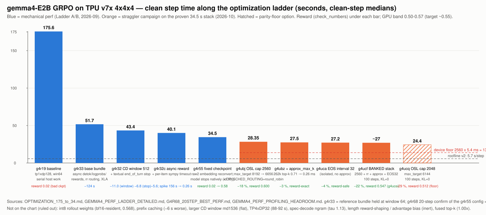
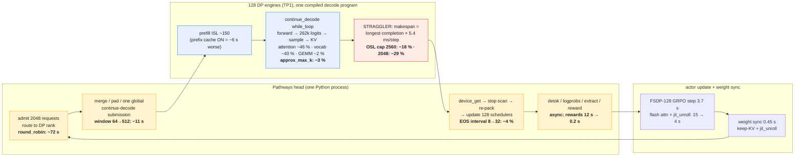

# gemma4-E2B GRPO on TPU v7x: the optimization path (roofline → levers → what is specific to gemma4)

**Scope.** gemma4-E2B GRPO/RLVR (OpenMathInstruct-2, 2048 completions/step = 256 prompts × 8) on one
tpu7x 4×4×4 slice (64 chips = 128 devices), MaxText + tunix + tpu-inference/vLLM under Pathways,
TP1×DP128. Every number below comes from a named run (`g4r*`, `g4ub*`, `g4uc*`) documented in this
directory; the per-run ledgers are `GEMMA4_PERF_LADDER_DETAILED.md`, `GEMMA4_PERF_LADDER_COMPLETE.md`,
`G4R68_20STEP_BEST_PERF.md`, `GEMMA4_HEADROOM_ANALYSIS.md`, `GEMMA4_PERF_PROFILING_HEADROOM.md`.
Accuracy parity against the GPU reference (GSM8K, scorer-v2) is a separate track:
`GEMMA4_E2B_GSM8K_ACCURACY_PARITY.md`.

**Endpoints.**

| milestone | clean step | reward (`check_numbers`) | run |
|---|---:|---:|---|
| first working full-slice baseline | 175.6 s | 0.02 (corrupted checkpoint) | g4r19 |
| mechanical perf stack + fixed checkpoint | 34.5 s (20-step median 35.7) | 0.58 | g4r55 / g4r68 |
| straggler campaign, full parity | ~27 s (26.9–27.6) | 0.547–0.600 (100 steps, KL = 0) | g4ucf / g4uco |
| straggler campaign, parity floor | ~24.4 s | 0.512 (GPU band floor 0.50) | g4ucq |
| **final recipe: response cap raised to 8192 to match the GPU reference** (latest image, p-state 6, GSM8K parity recipe) | **46.4 s** (updates 2–19) | accuracy parity run in progress | g4lp8k |

175.6 → 27 s is 6.5× end to end; the last 34.5 → 27 s (−22 %) is the part that needed the
roofline to find.

---

## 1. Finding the gap: three rooflines, three different answers

### 1.1 Measured phase split (how we look at a step)

`patch_phasetime.py` / `patch_perf_v2.py` print per-step `run_global_step`, `engine_generate`
(rollout), `micro_batch_steps − generate_and_advantage` (trainer), `weight_sync_time`,
`compute_rewards`; `patch_lendist.py` prints OSL/ISL/truncation. Clean-step medians exclude the
compile step and contention wobbles.

| config | rollout | trainer | weight-sync | rewards | global | rollout share |
|---|---:|---:|---:|---:|---:|---:|
| g4r19 baseline (win64, serial host) | 127.0 | ~15 | ~1.0 | 12.0 | 153.0 (175.6 median) | 84 % |
| g4r20b reward/prompt fix | 118.0 | ~8 | 0.5 | 2.0 | 130.5 | 90 % |
| g4r38 host-work levers | 48.5 | 4.2 | 0.45 | 1.8 | 56.3 | 86 % |
| g4r55 champion win512 + fixed ckpt | 31.5 | ~4.0 | 0.45 | 0.21 | 35.6 | 88 % |
| g4r68 same, 20 steps (n = 16 clean) | 31.3 | 3.7 | 0.45 | 0.23 | 35.7 ± 0.78 | 88 % |
| g4r55b parity run (TB `perf/train/*`) | 28.6 | 0.6 | 0.4 | — | 33–34 | 86 % |

Single-turn GRPO on this model is rollout-bound at every rung. Trainer, weight sync and rewards
were driven to their floors early (15 → 4 s, 1.0 → 0.45 s, 12 → 0.2 s) and never mattered again.

### 1.2 Roofline v1 (2026-09-01): weights-only → "30–50× headroom", the host is the enemy

Per device (TP1 replica): 2.3 PFLOP/s bf16, **7.37 TB/s HBM**, ridge ≈ 313 FLOP/byte. Decode at
batch 16 seqs/rank has arithmetic intensity ≈ 15, far below the ridge, so the kernel sits on the
memory roof: ~5.2 GB active weights + ~0.7 GB KV per iteration ≈ 0.81 ms; with the full 9.26 GB
bf16 weight set resident at TP1 it is 1.3 ms. Ideal step ≈ 4–6 s (decode 2.6 + prefill ~1 +
trainer 0.4–1 + sync ≪ 1).

Against 175.6 s measured that is a 30–50× gap, and every trace agreed on where it was:
devices ~2–3 % busy during rollout (52 ms of device work inside a ~2.5 s wall window at DP128);
`device_get` ≈ 546 ms vs 15 ms device per window; host 97–98 % of wall. The serial Python head
pays ~2.4 s per 64-token continue-decode window at DP128 (0.78 s at DP64, 1.0 s at DP32 — the cost
scales with the number of engines it must talk to through the Pathways proxy).

Headroom decomposition (`GEMMA4_HEADROOM_ANALYSIS.md` §3):

| id | owner of the gap | size on the g4r19 basis |
|---|---|---|
| H1 | head-loop round-trips (~50 windows × ~2.4 s) | ~85–105 s of the 125–130 s rollout |
| H2 | wasted decode from a broken stop contract (untrained `<|turn>` ids; 64–78 % truncation) | ~25–35 s + corrupted signal |
| H3 | sequential host post-processing (detok, logprobs, reward) | 8.5–17.5 s |
| H4 | reward tail spikes (hard sympy batches) | +80–120 s on ~1 of 7 steps |
| H5 | KV-wave rollout spikes | +100–170 s on ~2 of 7 steps |
| H6 | trainer inflation (TMBS 4, 262k-vocab logits) | ~14 s |
| H8 | one head process serially driving 128 engines | the residual ~10× under ~50 s |

This roofline was right about the direction (host) and produced the 175.6 → 34.5 s ladder in §2.

### 1.3 Roofline v2 (2026-09-04): healthy model → 5.7 s/step, "6.3× gap, all host"

Recomputed with the fixed checkpoint's measured OSL (~1450 and falling, 3–10 % truncation):
decode 4.4 s (1.26 ms/iter × ~3500 straggler iterations) + trainer 0.8 + prefill 0.02 + sync 0.5
= **5.7 s/step**. Best measured 35.7 s (g4r68) → 6.3× gap; rollout 31.4 s decomposed as
5.2 s device (8 windows × 646 ms) + ~26 s serial host (~3.3 s/window: gather → stop-scan →
re-pack → 2048 per-request dispatch IPCs). The recommended lever was window double-buffering
with deferred host processing (target ~13 s/step).

That recommendation did **not** survive measurement: `async_scheduling=True` (the engine's
double-buffer, g4r61) was perf-neutral (34.5/36.0 s vs 34.5–37.2 s) and deeper windows were flat
(`max_decode_steps` 1024 → 1536, g4ubx: 28.35 s both). Per-window orchestration was not on the
critical path after all.

### 1.4 What the xplane and the straggler said (2026-10-23)

Device-op composition of a gemma4-E2B decode step (`decode_only` xplane, TP4 capture):

| device-op share | TPU:6 | TPU:4 |
|---|---:|---:|
| RPA attention over growing KV (`bkv_8192/8448-sw_512`) | 44.1 % | 48.1 % |
| 262 144-vocab logits + sampling (`f32[262144,64]` reductions, top-k fusion) | 42.1 % | 37.2 % |
| collectives (TP4 logit all-gather; disappears at TP1) | 7.6 % | 8.2 % |
| weight GEMM | 2.1 % | 2.3 % |

The weight matmul the v1 roofline was built on is ~2 % of device time. Per-plane profiling then
showed the ~60 % `collective-permute-done` time was a **barrier wait on load imbalance**: ~8 chips
grind the longest completions (~16 ms windows, 44–51 % compute) while ~24 chips finish in ~3.6 ms
and block. XLA combiner/overlap flags measured 0 % overlap — a barrier, not bandwidth.

**Makespan law.** Decode is token-serial per sequence and batched within a rank, so
`rollout ≈ (longest of the 2048 completions) × (per-step time)`. Work-stealing cannot help
(`patch_worksteal_a.py` migrated 7–8 seqs/step, regressed to 89 s at reward parity): moving a
sequence does not make it decode faster. Only the two factors matter: per-step time, and the
longest length. The longest completions are coherent math reasoning, not repetition; at the 8192
cap 46–76 % of sequences never terminate and earn ~0 reward; and long completions can be correct
(`score=1.0` at 8538 and 8473 chars ≈ 2100–2500 tokens).

### 1.5 Roofline v3 (2026-10-24): the per-step floor is 5.4 ms, device-bound

`patch_cd_timing.py` (prints on the Pathways head, which is why six earlier attempts saw nothing)
measured the continue-decode window wall directly: 5.90 / 5.13 / 6.03 / 4.93 s per 1024-step
window → **4.8–5.9 ms per decode step, constant whether 2048 or 494 sequences are active**.
Windows run back-to-back with no host gap. The "7× gap" of v1/v2 was an artifact of a
weights-only floor (1.3 ms) that ignored attention over the KV and the 262k-vocab forward/sampling
path (~4 ms). Pure decode runs at ~2.4 ms/token, ~1.8× the weight-stream floor.

Microbenchmarks closed the kernel question: RPA v3 at head_dim 256 default tiles 80.6 µs/call
(forced 4096 = 82.7, 8192 = 106.0, 16384 = 98.8; all correctness-identical) and the production
manifest already runs the default; forward matmuls 3.48 ms at 36 % HBM BW (latency-bound at
batch 16); exact top-k over 262144 = 0.709 ms vs `approx_max_k` 0.263 ms at recall 0.99;
whole-step fusion worth 4.3 % (XLA already pipelines). The device is at its practical floor;
**the reclaimable gap is the straggler's length.**

---

## 2. The ladder: every lever, its rationale, and what it bought

### 2.1 Ladder A/B — mechanical perf, 175.6 → 34.5 s (2026-09)

| # | lever | rationale (which gap) | mechanism | before → after | Δ | reward effect | status |
|---|---|---|---|---|---|---|---|
| 0 | OOM trio: flash trainer attention + `chips_per_vm=8` + `kv_cache_buffer=4352` | full-slice TP1×DP128 would not run: train step asked 80.3 GB vs 36.7 GB free (bf16 logits + grad over 262k vocab); nine step-1 sync-boundary OOMs | shrink the resident program, correct device/VM mapping | no run → 175.6 s (g4r19) | — | — | banked |
| 1 | reference base bundle (g4r30 → g4r33 at win64): async detok / logprobs / rewards, deep-window scaffolding, TMBS 8, 29-flag XLA proxy ladder | H1/H3: host work serial on the critical path | overlap host post-processing with decode; XLA flags are load-bearing for deep-window stability (g4r31 = same minus flags died at step 1) | 175.6 → 51.7 s | **−124 s** | 0.02 (old ckpt) | banked |
| 1a | of which **round-robin DP routing** (`DP_SCHED_ROUTING=round_robin`) | H1: the default `least_loaded` router asks every one of 128 ranks its queue state per request = ~2048 proxy IPCs per window, serially on the head | local `counter % 128`, zero IPC; uniform 256×8 workload balances anyway | 130.5 → 58.4 s (g4r20b → g4r56) | **−72 s (≈96 % of the bundle)** | 0.53–0.59 unchanged | banked |
| 1b | async detok (g4r57), async logprobs + fast extract (g4r38) | H3 | off critical path | 58.4 → 59.8 → 56.3 s | ≈ 0 on top of rr | unchanged | kept (free) |
| 2 | continue-decode window 64 → 512 (`patch_cd_proper`/`cd_masking`/`cd_report`) | H1: 8× fewer head round-trips per rollout | one global decode submission per 512 tokens; correctness patches make deep windows valid | 51.7 → 40.7 s (g4r33 ↔ g4r32b) | **−11.0 s** | unchanged | banked (reference launcher lineage; our launcher crashed at 512) |
| 3 | textual `<end_of_turn>` stop (`patch_textual_stop`) | H2: after answering the model invented new user turns 49 markers deep to the 4096 cap (GPU vLLM stops on strings, the TPU fused loop only on ids) | scan each window for the 7-BPE marker, retire the request | 50.2 → 43.4 s (g4r30 ↔ g4r32); OSL 3550 → 1900, truncation 85 → 40 % | **−6.8 s** | correct-answer density +~40 % | retired later: fixed ckpt stops natively on id 106 (g4r69: 36.6–37.1 s, 3.1 % truncation) |
| 4 | async reward (`patch_async_reward`, score during rollout) | H3/H4 | reward pool runs during decode tail | 46.3 → 40.7 s (g4r35 ↔ g4r32b) | **−5.6 s** | unchanged | banked |
| 5 | per-item sympy timeout + partial-async rescore (`patch_verify_timeout`) | H4: one hard batch serialized 32 items/proc | per-item timeout 5 s | step-8 reward 156 → 0.26 s (g4r32c) | tail only; median 40.1 s | unchanged | banked |
| 6 | checkpoint fix: reconvert embedding from HF safetensors → `raw2` | correctness, found via reward 0.02: every embedding row normalized to √1536, directions rotated, worst on turn/stop tokens | `DL_CKPT_PATH=raw2` (row audit cos 0.999999, forward KL 5.3e-3 vs HF) | 40.1 → 34.5 s (g4r32c → g4r55); 20-step confirm 35.7 ± 0.78 s (g4r68) | **−5.5 s** free: healthy model emits its stop token, ~30 % shorter completions | **0.02 → 0.58** (GPU parity) | banked |
| 7 | trainer: flash/splash attention, `jit_unroll` (1 dispatch vs ~290), keep-KV across sync, numpy packer, GC gating | H6 | fewer dispatches, no KV reset | trainer 15 → ~4 s; sync 1.0 → 0.45 s; packer −4.7 s dequeue | ~−12 s cumulative | unchanged | banked |
| — | TMBS 8 / HBM 0.3 (g4r40); TMBS 16 (g4r53) | H6 | — | 56.3 → 56.3 s; −7…10 s on a 120 s base | null | — | dropped |
| — | `async_scheduling` double-buffer (g4r61) | H8 | overlap window N+1 dispatch with host processing of N | 35.6 → 35.6 s | ~1 s | 0.58 unchanged | kept, not a lever |
| — | TP4×DP32 (g4r50) | mesh | — | 88–92 s | worse | — | rejected |
| — | response cap 8192 (g4r52), prefill rebalance MPPL 1024 (g4r59) | quality (truncation → 0) | — | +15 s | worse | truncation 0.05 % | quality knobs, not perf |
| — | prefix caching ON | — | — | −6 s/step **worse** when on (run 33j); ISL ~150 makes prefill negligible | worse | — | rejected |

### 2.2 Straggler campaign — 34.5 → 27 s at full parity, 24.4 s at the floor (2026-10-23/24)

Method: 3–5-step probes on the ubench pool, step 1 compile-inflated and skipped, clean steps 2–4;
then 100-step runs with `tb_parity.py` sustained-parity verdicts (GPU band `check_numbers`
0.50–0.57, target ~0.55; `score/mean` 0.54–0.65). Reward is not persisted by the stack, so it is
measured by `REWARD_DUMP_N=512` and averaged.

| # | lever | rationale | mechanism | before → after | Δ | reward | status |
|---|---|---|---|---|---|---|---|
| 8 | **`DP_SCHED_ROUTING=round_robin`** (the manifest's `DP_ROUTING=rr` was a dead env var) | the least_loaded router was back, probing 128 ranks × 4 per request | correct env name | step-1 43.9 → 40.8 s | **−3.1 s** | — | banked |
| 9 | deeper CD window md 512 → 1024 (g4ub3) | fewer barriers | — | → 31.7 s | small | 0.560/0.604/0.586 | banked (md 2048 OOMs; 1536 flat) |
| 10 | **OSL tail cap**: `max_target_length` 8192 → 6656 (response 2560, prefill 4096) (g4ubj) | makespan = longest completion × per-step; 46–76 % of sequences ran to the 8192 cap with ~0 reward | hard per-sequence cap bounds the worst-of-2048 | 34.5 → 28.35 s | **−18 %** | 0.600 (full parity) | **banked knee** |
| 10a | response 3072 (g4ubi) | milder cap | — | ~29.5 s | −14 % | 0.599 | dominated by 2560 |
| 10b | response 2304 (g4ucr, 100 steps) | between | — | ~27 s | = 2560 | 0.531 | dominated (same speed, lower reward) |
| 10c | **response 2048** (g4ubh 5-step; g4ucq 100-step) | aggressive | truncates some correct answers (correct completions reach ~2900 tok) | 24.3 s / **24.4 s** (median 25.3) | **−29 %** | 0.559 (5-step) → **0.512** sustained, at the 0.50 floor | option, not default |
| 11 | **`approx_max_k`** replaces `topk_mask` (`patch_approx_topk.py`, `APPROX_TOPK=1`) (g4ubz) | exact top-k over 262 144 = 0.709 ms/step; hardware approximate top-k 0.263 ms, recall 0.99, 0.12 % miss | sampler renormalizes over the returned set | 28.35 → 27.5 s | **−3 %** | 0.5996, 0.000 % kept-token diff | banked |
| 12 | **`CONTINUE_DECODE_EOS_CHECK_INTERVAL` 8 → 32** (g4uca) | per-step host EOS check is on the critical path | check every 32 tokens | 28.35 → 27.2 s | **−4 %** | 0.5996 (outputs unchanged) | banked; 64 is worse (27.8 s, g4ucb) |
| 13 | stack 10 + 11 + 12 (g4ucc, reproduced g4ucf) | independent mechanisms (device top-k vs host break) | — | 26.4–27.6 s | **−22 % vs 34.5** | 0.5996; 100-step g4uco 0.547 flat, KL = 0 | **deployable** |
| — | int8/W8A8 rollout weights via qwix (g4ube…g4ubn) | halve the 9.26 GB weight read | three trace crashes fixed (`mtp_num_layers`, batch/seq rounding) and it ran | no HBM win: weights stay bf16-resident; GEMM is 2 % of device time | — | 0.568 | rejected |
| — | fused top-k/temperature/top-p sampler | keep post-top-k math on [batch, k] | 17/17 unit tests pass | 1.00–1.01× on TPU at batch 16/64/256 | 0 | — | rejected (cost is the top-k reduction itself) |
| — | "fuse sampling/KV into decode" | fewer launches per step | already done: `continue_decode` is one `while_loop` with forward → sample → KV update (fusion worth 0.44 ms/step in the CD-off regime) | — | 0 | — | already in |
| — | larger `max_decode_steps` 1536 (g4ubx), SPMD/MPMD/fewer launches | fewer windows | — | 28.35 → 28.35 s | flat | 0.5898 | dead family |
| — | spec-decode (ngram, needs CD off + async; g4uby) | fewer forwards for the longest sequence | — | crash-looped; measured n-gram acceptance τ = 1.13 tokens/forward on real completions (math has little literal repetition) | ≤ 0, CD-off penalty erases it | — | dead; EAGLE3 (5–9 weeks) unjustified by τ |
| — | RPA decode block sizes (g4uci 1,8192,1,2048) | tile tuning for head_dim 256 | — | 27 → 29 s | worse | 0.5996 | default tiling already fastest (microbench) |
| — | work-stealing A (re-prefill) / B (KV-block migration) | fix the idle chips | A ran: migrated 7–8 seqs/step | 89 s | worse | parity held | dead: moves work, not makespan |
| — | length reward-shaping λ = 0.25 / 1.0 (g4ucn/g4ucp vs control g4uco) | shorten the straggler at the source | penalty on total reward, parity metric untouched | n_chars p90 flat ~6550 | 0 | 0.55 flat | inert: GRPO ÷std cancels a near-constant penalty inside all-wrong groups |
| — | post-norm advantage bias on wrong completions, λ = 0.5 / 2.0 (g4ucs/g4uct) | defeat the ÷std cancellation | `A_i −= λ·clip((len−T)/S)` after normalization | `max_length` pinned at 2560 all 100 steps | 0 | 0.546/0.547 | inert: a max-of-2048 needs P(len > cap) < 1/2048, reweighting shifts the center only |
| — | bf16 logits, vocab-parallel unembed | device slivers | embed table is already bf16 (9.26 GB == measured 9.23 GB stream); f32 logits are 0.18 % of the stream; vocab TP regresses a TP1×DP128 2B model | — | — | sampling in f32 is a reward invariant | closed by roofline |

**What the campaign proved about the model.** The makespan-setting completion naturally lands at
~2048–2300 tokens, so 2560 vs 2304 truncates nothing (identical ~27 s) while 2048 bites (−2.6 s)
by trading reward to the floor. OSL 2560 is the knee because it is the length correct answers
actually require. Lowering it needs a training-objective change (owner's call), not a flag.

---

## 3. Why gemma4-E2B is not qwen3-0.6b

Same slice (4×4×4, Pathways, GRPO, 2048 completions/step) and the same Tianyu optimization stack,
measured 2026-08-21 (`README.md`, `GEMMA4_PERF_REPORT.md`):

| | qwen3-0.6b (`tianyu-rl-17a`) | gemma4-e2b (`g4r1c`, pre-ladder) |
|---|---|---|
| global step (median) | 133.6 s | 271.2 s |
| rollout | 105.4 s | 145.5 s |
| trainer segment | ~25.1 s | 108.1 s |
| rewards in-step | 2.8 s | 12.6 s (spiky 4–103) |
| completion cap / truncation | 8192 / ~23 % | 4096 / ~81 % |
| tokens generated per step | ~7.6 M (OSL mean 3708) | ~6.8 M (OSL mean 3332) |
| rollout throughput | ~72k tok/s | ~48k tok/s |
| train micro-batch (grad-acc) | 32 (8 microbatches) | 1 (256 microbatches) |
| CD window / EOS interval | 128 / 8 | 64 / 1 |
| model route | native `Qwen3ForCausalLM` | MaxText-backed `MaxTextForCausalLM` |

What made the qwen3 playbook transfer only partly:

1. **Vocabulary 262 144 vs 151 936 — the logits are the whale, twice.** In the trainer the RL loss
   materializes full per-token logprobs: `[tmbs, 8192, 262144]` f32 = 8.59 GB per sequence and
   130 G of temporaries at TMBS 4 vs 94.7 G available, replicated (no batch axis on the
   `(data=1, fsdp=64)` mesh) → TMBS pinned at 1 (108 s trainer) until flash attention, sequence
   chunking (PR #4409 → TMBS 2) and the FSDP-128 full-slice mode brought it to ~4 s. qwen3 runs
   TMBS 32 on a 9.96 GB-per-sequence tensor because its logits shard. In the sampler the 262k
   top-k is ~0.7 ms of a ~5.4 ms decode step; `approx_max_k` is a gemma4-sized lever (−3 %) that
   is worth little at 152k.
2. **Architecture: 35 unscanned layers with cross-layer KV sharing (20 of 35 share), head_dim 256
   MQA (1 KV head), per-layer embedder lookups.** `scan_layers=False` is forced (nn.scan cannot
   express shared KV across non-identical layer bodies), which makes compile and the train HLO
   larger (gemma4's unscanned 262k-vocab train HLO is the compile-time hog, ~25 → ~13 min after
   fixes). head_dim 256 doubles KV bytes per token vs qwen3's 128, which is why the e4b recipe
   inherited 8192/4096 instead of qwen3's 16384/8192, and why attention over the growing KV is
   ~46 % of decode device time. RPA v3 has a specialized kernel only for head_dim 64; gemma4 runs
   the general kernel, whose default tiling turned out to be the fastest (80.6 µs/call).
3. **Per-token cost is legitimately ~1.5× qwen3's** (48k vs 72k tok/s) for ~3–4× the compute per
   token; the rollout port itself was efficient from the start. The 2× step gap in August was
   trainer microbatching (108 vs 25 s) and the reward tail, not decode.
4. **The stop contract.** This checkpoint's canonical `<|turn>` ids were untrained (0 correct
   answers in 131 000 completions, g4r19) and the model talked to itself past `<end_of_turn>` 49
   markers deep. qwen3 never needed a textual-stop scanner; gemma4 needed it until the embedding
   was reconverted (`raw2`), after which the model stops natively on id 106 and the scanner was
   retired (g4r69).
5. **Dispatch shape.** qwen3's CD 128 / EOS 8 setting did not help gemma4 at window 64 (scout
   g4s1: ~150 s rollout either way) — gemma4 was not dispatch-bound at that shape; the win came
   from 512 only after the correctness patches made deep windows valid.
6. **Long-tail completions.** gemma4 reaches the cap far more often (81 % at 4096 pre-fix; 46–76 %
   non-terminating at 8192 on the healthy model's math prompts), so a makespan law dominates and
   the OSL cap — a lever that barely matters on qwen3's 23 %-truncation regime — is worth −18 %
   to −29 % here. Conversely qwen3's mesh choice (colocated dp16×tp8) and its RPA tuple
   (1,1024,1,1024) were not adopted: TP > 1 regresses this 2B model at DP128 (TP2 ≈ 2× worse,
   g4ub4; TP4×DP32 88–92 s, g4r50) because every decode step would all-gather the 262k logits.

A qwen3 perf ladder is not kept in this repository (only its launch configs under
`qwen3/tianyu-rl-17a/`); the comparison above uses the one matched-slice measurement in
`README.md` and the knob audit in `tuning/TIANYU_RL17_COMPARISON.md`.

---

## 4. Final state and what is left

| operating point | step | reward | notes |
|---|---:|---:|---|
| **banked / deployable**: OSL cap 2560 (`max_target_length=6656`, `max_prefill_predict_length=4096`) + `DP_SCHED_ROUTING=round_robin` + `APPROX_TOPK=1` + `CONTINUE_DECODE_EOS_CHECK_INTERVAL=32`, CD on, md 1024 | **~27 s** (26.9–27.6, g4ucf) | 0.547 flat over 100 steps, KL = 0 (g4uco); 0.5996 on 5-step dumps | −22 % vs 34.5 s; all levers reward-gated |
| aggressive: same with OSL cap 2048 (`max_target_length=6144`) | **~24.4 s** (median 25.3, g4ucq) | 0.512, at the 0.50 floor | −29 %; truncates some correct answers |

Roofline bookkeeping at the end: rollout ≈ 2560 × 5.4 ms ≈ 13.8 s is the device floor for the
longest allowed completion; the measured ~25 s rollout includes the early mixed prefill/decode
phase and per-window tails; trainer 3.7 s vs ~0.8 s roofline is the only other non-floor item and
is small in absolute terms.

**Final cap alignment (2026-10-30).** The GPU reference trains with `max_response_length=8192`
(`parity/logs/gpu_reference_verl_config.txt`), so the deployed recipe was moved from the capped operating
points (2048 / 2560) to **cap 8192** on the latest image at p-state 6. That is a deliberate performance
regression: 28.9 s (latest image, cap 2048) → **46.4 s per update** at cap 8192, from the uncapped rollout tail
and trainer padding to 8704 tokens; truncation goes from 0.05–2.2 % to 0 %, and the comparison with the GPU
(31.7–35.0 s per update on 128 GPUs) is now like for like. Details and the recipe:
`GEMMA4_E2B_OPTIMIZATION_REPORT_CAP8192.md`. The capped points above remain valid where a rare truncated tail is
acceptable.

Remaining paths, none autonomous:
- **Training-objective change to shorten the straggler at the source** (format compliance 82 % vs
  GPU 98.5 %; multi-day horizon study). It changes the reward signal, so it is owner's sign-off
  and interacts with the parity constraint.
- **CD-capable device profiling** to split the ~4 ms non-weight per-step cost further (real
  engineering against Pathways/MPMD opacity; expected ≤ 1–2 % wins such as scheduler/padding).
- Head parallelism (`TPU_MULTIPROCESS_DP`) remains Pathways-gated upstream.

Accuracy parity on the customer's GSM8K recipe (scorer-v2, GPU reference curve, 3-seed gate) is
tracked separately in `GEMMA4_E2B_GSM8K_ACCURACY_PARITY.md`; the recipe there deliberately keeps
OSL 2560 and the straggler levers off the critical path of the gate.

---

## Appendix A — Mermaid fallback for the pipeline figure

## Appendix B — knob / patch index for the banked stack

| knob or patch | value | lever |
|---|---|---|
| `DP_SCHED_ROUTING` | `round_robin` | #1a / #8 |
| `max_decode_steps` (vllm_additional_config) | 1024 | #9 |
| `max_target_length` / `max_prefill_predict_length` | 6656 / 4096 (2560-token responses) | #10 |
| `APPROX_TOPK` + `patch_approx_topk.py` | 1 | #11 |
| `CONTINUE_DECODE_EOS_CHECK_INTERVAL` | 32 | #12 |
| `VLLM_BLOCK_SIZE` | 128 | engine shape pin |
| `patch_cd_proper` / `patch_cd_masking` / `patch_cd_report` | — | deep-window correctness (#2) |
| `patch_async_reward` / `patch_async_detok` / `patch_async_logprobs` / `patch_fast_extract` | — | #1b / #4 |
| `patch_verify_timeout` (`VERIFY_ITEM_TIMEOUT=5`) | — | #5 |
| `patch_flash_sa`, `patch_jit_unroll`, `patch_sync_keepkv`, `patch_packer_fast` | — | #7 |
| `load_parameters_path` | `gemma4-e2b-raw2` (perf runs) / `gemma4-e2b-it-fresh` (parity runs) | #6 |
| `skip_first_n_steps_for_profiler` | > `num_batches` when the phased profiler is on | avoids the double-trace crash |
| `patch_phasetime`, `patch_lendist`, `patch_reward_dump`, `patch_cd_timing` | — | instrumentation the numbers above come from |
