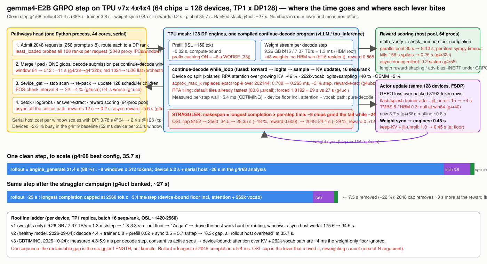

# gemma4-E2B GRPO on TPU v7x at response cap 8192: optimization report

**Scope.** gemma4-E2B GRPO/RLVR on the GSM8K parity recipe (128 prompts × 16 samples = 2048 completions per
update, token TIS, scorer-v2), one tpu7x 4×4×4 slice (64 chips = 128 devices), MaxText `train_rl` + tunix +
tpu-inference/vLLM under Pathways, TP1×DP128, **p-state 6**, **response cap 8192** (`max_target_length` 8704 =
512 prefill + 8192), the cap the GPU reference uses (§3). Image: the latest `maxtext-rl-ironwood`
(`2026-09-22-head`, sha256 `4dc6ca72…`: jax 0.11.0, libtpu 0.0.44, vLLM 0.28.1rc1, transformers 5.12.1;
Pathways `20261028-jax_0.11.0`). Every number comes from a named run (`g4l24fc8k`, `g4lp8k`); logs and
step-time tables are under `parity/logs/latest_image/`.

**Performance record (median of training updates, `run_global_step`, no eval/checkpoint updates).**

| run | updates measured | median | min / max | note |
|---|---|---:|---|---|
| `g4l24fc8k` (10-update check) | 2–9 | 49.0 s | 43.6 / 113.5 s | first cap-8192 run on the latest image |
| **`g4lp8k` (250-update parity run) — banked number** | **2–19** | **46.4 s** | 37.23 / 69.01 s | update 20 (202.10 s) carries the eval and the checkpoint and is excluded |

Truncation at the cap: **0 of 2048 completions on every update**; mean rollout length 442.7-533.3 tokens; step-0
accuracy 80.82 %, step-21 accuracy 91.21 % (GPU step-20 mean 91.03 ± 0.53).

---

## 1. Where the time goes at cap 8192

Per-update phase medians over updates 2–20 of `g4lp8k` (`PHASETIME`, head-pod stdout):

| phase | median | what it is |
|---|---:|---|
| `engine_generate` | 27.1 s | 2048 completions on 128 DP ranks; the makespan is the longest completion in the batch |
| advantage + reward (async scorer) | 3.2 s | reward scoring overlaps the decode tail; the remainder is advantage + data prep |
| trainer (TIS recompute + 16 micro-batches of 8) + weight sync | 13.2 s | sequences padded to 8704 |
| **`run_global_step`** | **46.4 s** | |

Two properties of cap 8192 set this budget:

1. **The rollout makespan is the longest completion, and nothing is truncated.** The mean completion is
   ~500 tokens, so 2048 completions finish quickly on average, but the slowest sequence on each rank runs
   to wherever the model stops. Updates whose batch contains one unusually long completion stand out
   (update 2: 69 s in `g4lp8k`, 113 s in the 10-update check; update 5: 56 s) and are deterministic for a
   given seed (same batch, same completion). The GPU reference has the same property at the same cap.
2. **The trainer pads to the cap.** The TIS recompute and the training micro-batches run on sequences padded
   to `max_target_length` = 8704 regardless of the real length, so the trainer phase is ~13 s for ~500 real
   tokens per sequence. This is the largest recoverable item (§5).

## 2. What it took to run cap 8192 on the latest image

| # | change | rationale | mechanism | status |
|---|---|---|---|---|
| 1 | latest image for every library | newest kernels; 13 of the 36 perf patches of the previous stack are upstreamed (round-robin DP routing, KV kept across weight sync, 128-token KV blocks, async detokenize/logprobs, jitted unroll, stop tokens, distributed sampling) and are now config knobs or defaults; the parity patcher re-based (`patch_sampler_is_newimg.py`) | image digest + Pathways tags in the manifest; `DP_SCHED_ROUTING=round_robin`, `free_kv_cache_during_weight_sync=false`, `vllm_block_size=128`; `patch_sharded_sampling` / `patch_flash_sa` skipped | banked |
| 2 | **KV-cache alias fix** (`parity/patches/patch_kv_alias_dedupe.py`) | the new MaxText-in-vLLM adapter expands tpu-inference's per-layer KV-cache map to 35 entries for gemma4-E2B's 15 physical caches (20 KV-shared layers alias donors 13/14) and scatters the stale alias entries back over the donors' updates: those layers never kept K/V and greedy decoding degenerated into repeated tokens (0 % accuracy) | one line in `hybrid_cache_utils.resolve_layer_kv_cache_indices`: present each physical cache once, in first-use layer order (= MaxText's slot order) | banked; 0.00 → 80.8 % at step 0 |
| 3 | explicit local-attention splash settings (`local_sa_*`, `eval_local_sa_*` = 512 / `HEAD_DIM_MINOR`) | the new `attention_op` reads these fields directly and the RL config leaves them `None` → crash at the first training step | config only | banked |
| 4 | **response cap 8192**: `max_target_length=8704`, `kv_cache_buffer=8704`; splash blocks 512 (divide 8704) | match the GPU reference (§3); remove truncation entirely | config only; vLLM HBM fraction 0.3 still holds the KV cache for 256 concurrent sequences × 8704 tokens | banked |
| 5 | async reward scoring, approx-max-k sampling, EOS-check interval 32 (inherited from the 24 s configuration) | keep the host work off the decode critical path | existing patches | banked |
| 6 | checkpoint every 20 updates + RNG-free resumable checkpoints + resume weight push; `tools/chain-seeds4.sh` | the cluster deactivates workloads 120 min after admission and evicts on node failures (four times on 2026-10-30); a 250-update run spans several admissions | delete + re-apply the same manifest → checkpoint restore; JobSets applied with an ownerReference (`tools/apply-jobset.sh`) because a kyverno policy strips ownerless JobSets since 2026-10-29 | banked |

Not used: p-state 7 (team setting is p-state 6); the OSL-tail levers of the earlier perf ladder (they change
the training problem and are off the table for a GPU comparison).

## 3. Why the GPU comparison has to use cap 8192

The GPU reference curve (verl + vLLM, 16 × 8 GPUs, runs `gemma4_e2b_gsm8k8k_16n64g_s250_seed{1,2,3}`) was
trained with **`max_response_length=8192`** and `max_prompt_length=512`. The launcher echo of the run logs
(`gs://xiaotongyang-bucket/meta-rl/GKE_repro/meta-RL/logs/`) is reproduced in
`parity/logs/gpu_reference_verl_config.txt`; on GPU the cap bit on one update out of 250
(`response_length/clip_ratio` 0 on 249 updates, max observed length 8192 once), and the GPU reward applies an
overlong penalty in a 512-token buffer below the cap.

A smaller cap is a different training problem: at 2048 the TPU truncates 0.05–2.2 % of rollouts on every update,
every truncated completion scores 0 under the boxed-answer reward (a correct but long chain of reasoning is cut
before `\boxed{}`), and the GPU's longest completions (1.5k–4.8k tokens on most updates) cannot exist. Earlier
TPU checks at cap 2048/2560 matched the GPU curve empirically because the mean rollout is ~500 tokens and the
truncated tail is rare, but that is agreement in spite of a recipe difference, not a like-for-like comparison.
**For any comparison with the GPU reference, the TPU recipe must use cap 8192, and the TPU performance number
that goes with that comparison is 46.4 s per update** (GPU seeds: 31.7 / 33.1 / 35.0 s per update on 128 GPUs,
same recipe, same cap).

## 4. Accuracy parity at cap 8192 (run `g4lp8k`, seed 42, 250 updates)

__PARITY_SECTION__

## 5. Final state and what is left

| item | value |
|---|---|
| recipe | `parity/manifests/g4lp8k-latest-image-cap8192-seed42-parity-250.yaml` (apply with `parity/tools/apply-jobset.sh`; resume with `parity/tools/chain-seeds4.sh`) |
| rebuild | `CAP=8192 FIX=patches/patch_kv_alias_dedupe.py STEPS=250 python3 parity/build_g4l24.py` (`STEPS=10` for a perf check) |
| performance | **46.4 s per update** (median, updates 2–19), p-state 6, latest image |
| phases | generate 27.1 s · advantage/reward 3.2 s · trainer + sync 13.2 s |
| truncation | 0 % |

Headroom at cap 8192, in order of size, none of which touches the accuracy curve: (1) trainer padding to the
cap: the recompute and micro-batches run at 8704 tokens for ~500 real tokens; packing or length-bucketing the
trainer would recover most of the ~13 s; (2) the rollout tail: the one longest completion per rank; only
training-objective changes shorten it, so it stays for the parity recipe; (3) the deterministic recompile at
update 6 and the one-off compile at update 0 (one-time costs).
