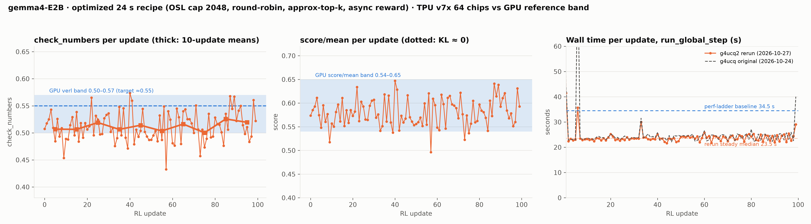

# gemma4-E2B optimized 24 s recipe: GPU ↔ TPU parity check report

**Result (run 2026-10-27 10:52–11:45 UTC, `g4ucq2`): parity holds.** The perf-optimized recipe
re-ran at **23.5 s per update (median; 23.8 mean)** on 64 tpu7x chips with its training reward
`check_numbers` = **0.5118** over 100 updates, inside the GPU reference band 0.50–0.57, flat (first 10
updates 0.507, last 10 0.520), `score/mean` 0.580 (band 0.54–0.65), KL 0. It reproduces the original
g4ucq run (0.5118, 24.0 s) to three decimals.



## 1. What the recipe is

The fastest point on the gemma4-E2B perf ladder ([`GEMMA4_E2B_OPTIMIZATION_PATH.md`](GEMMA4_E2B_OPTIMIZATION_PATH.md)):
OpenMathInstruct-2 train_1M, 256 prompts × 8 samples per update, prefill 4096, **response cap 2048**
(`max_target_length=6144`), T 0.8 / top_k 50 / top_p 0.95, LR 1e-6, 100 updates, checkpoint
`gemma4-e2b-raw2`, plus the banked perf levers: round-robin DP routing, `approx_max_k` sampling,
EOS-check interval 32, async reward and async logprobs, splash/RPA tiling defaults. Manifest:
[`parity/manifests/g4ucq2-optimized-24s.yaml`](parity/manifests/g4ucq2-optimized-24s.yaml) (identical
to the original `g4ucq` except the run name, `maxRestarts` 50 → 3 and the non-default Pathways
head ports 29140/29141).

## 2. The parity standard for this recipe

This workload has no held-out eval in the recipe, so parity is judged on the **training reward**
against the GPU verl reference for the same task: `check_numbers` (fraction of sampled answers whose
number matches the gold) in **[0.50, 0.57], centre ≈ 0.55**, and `score/mean` in **[0.54, 0.65]**,
sustained (no drift) over the run with KL ≈ 0 to the reference policy. The scorer is the recipe's own
`check_numbers` / `score` on both sides. (The GSM8K held-out accuracy-curve parity is the separate
[`GEMMA4_E2B_GPU_TPU_PARITY_REPORT.md`](GEMMA4_E2B_GPU_TPU_PARITY_REPORT.md).)

## 3. Method

1. Apply the manifest (one 64-chip JobSet, Kueue queue `multislice-queue`); the launcher applies the
   perf patches at pod start and writes tensorboard scalars to `gs://ubench-logs/g4ucq2/tensorboard/`
   and per-update phase timings to `gs://ubench-logs/g4ucq2/phasetime/step_*.json`.
2. Score with [`parity/tools/tb_parity.py`](parity/tools/tb_parity.py) (pure-stdlib tensorboard reader):
   overall / first-10 / last-10 `check_numbers`, `score/mean`, KL, drift, verdict against the band.
3. Step time from the phase-timing records (`run_global_step`, `engine_generate`, `compute_rewards`),
   steady state = updates 5–99 (updates 0–1 carry compilation and reward-pool warm-up on both runs).

## 4. Results

| quantity | value |
|---|---|
| `check_numbers` overall (100 updates) | **0.5118** — in [0.50, 0.57] |
| first 10 / last 10 updates | 0.5068 / 0.5195 (drift +0.013, flat) |
| per-10-update `check_numbers` | 0.507 / 0.507 / 0.519 / 0.506 / 0.514 / 0.504 / 0.516 / 0.500 / 0.526 / 0.519 |
| `check_numbers` min / max per update | 0.433 / 0.574 |
| `score/mean` overall, min / max | 0.580, 0.496 / 0.647 |
| run_global_step rerun (median / mean / p90, steps 5–99) | 23.5 / 23.8 / 25.0 s |
| run_global_step original (median / mean / p90) | 24.0 / 25.0 / 25.3 s |
| engine_generate rerun / original (median) | 20.0 / 20.6 s |
| compute_rewards rerun / original (median, async) | 0.21 / 0.22 s |
| KL (actor/train/kl) | 0.000 every update |
| verdict (`tb_parity.py`) | **SUSTAINED GPU PARITY** |

Context from the perf ladder (100-update runs, same scorer): OSL cap 2560 → 27 s at 0.547 (band
centre); OSL cap 2304 → 27 s at 0.531; **OSL cap 2048 → 24 s at 0.512** (band floor). The 24 s recipe
buys −29 % step time vs the 34.5 s baseline for ≈ 0.035 of reward; it is the aggressive edge of
parity, the 27 s / 2560 recipe is the comfortable one.

## 5. Evidence

* Scorer output: [`parity/logs/optimized_g4ucq2_tb_parity.txt`](parity/logs/optimized_g4ucq2_tb_parity.txt)
* Per-update series (check_numbers, score/mean, kl, phase timings for the rerun and the original):
  [`parity/logs/optimized_g4ucq2_series.json`](parity/logs/optimized_g4ucq2_series.json)
* Head-pod log extract (config echoes, LENDIST, PHASETIME, REWARD lines):
  [`parity/logs/optimized_g4ucq2_key_lines.log`](parity/logs/optimized_g4ucq2_key_lines.log)
* Raw outputs: `gs://ubench-logs/g4ucq2/{tensorboard,phasetime,lendist,debug_rl_logs}/`

```
check_numbers: steps=100 first10=0.5068 last10=0.5195 overall=0.5118 min=0.4326 max=0.5737  trend(last-first)=+0.0127
score/mean:    overall=0.5800 last10=0.5890 min=0.4965 max=0.6470
kl:            overall=0.000000 max=0.000000  (FLAT ~0)
per-10-step check_numbers: 0.507 0.507 0.519 0.506 0.514 0.504 0.516 0.500 0.526 0.519
=== PARITY VERDICT (GPU ref: check_numbers 0.50-0.57, ~0.55; score 0.54-0.65) ===
  overall check_numbers 0.5118 IN [0.50,0.57]  | drift 0.0127 (flat)  | kl ok
  => SUSTAINED GPU PARITY
LENDIST step=1 n=2048 cap=2048 truncated=546 (26.66%) eos_at_cap=0 osl_mean=1210.2 isl_mean=147.5
PHASETIME step=94 compute_rewards=0.21 engine_generate=19.63 … run_global_step=22.88
```

## 6. Caveats

* Reward-band parity, not held-out accuracy: the recipe trains on OpenMathInstruct-2 and reports the
  training reward; the GPU band comes from the verl reference on the same task.
* Run as the perf stack is banked (no token-TIS correction; the GPU reference for this task did not use
  it either). A TIS-on variant manifest (`g4ucq2t`, built by `parity/build_g4ucq2.py` with `TIS=1`)
  exists if that comparison is wanted.
* 26 % of rollouts are truncated at the 2048 cap by design; that is the lever that produces the −29 %.
