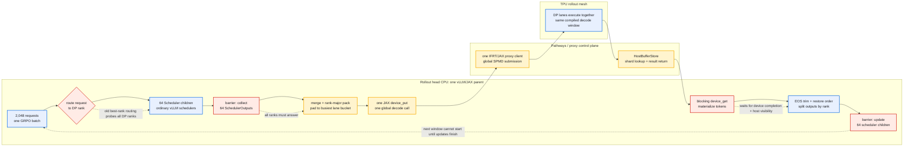
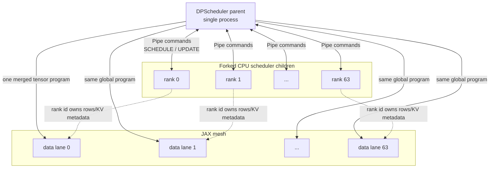

# DP Scheduling and Pathways Bottleneck Summary

This is the short version of the G4R7B/Gemma4 rollout control-plane finding.
It explains why high DP does not automatically mean high host parallelism under
Pathways, and why Tianyu's later wins came mostly from reducing how often the
host has to rendezvous with Pathways.

Companion deep dive: [G4R7B_DP_SCHEDULING_E2E.md](G4R7B_DP_SCHEDULING_E2E.md).

## One-Sentence Model

`DPScheduler` gives us many logical DP lanes, but Pathways still sees one
global JAX submission per decode window from one parent process. The parent must
route, merge, pad, submit, wait, materialize, split, and update before the next
window can start.

## Vivid Critical-Path Diagram

The red boxes are the serial control-plane choke points. The TPU box is wide,
but it is entered through one narrow gate per decode window.

## What DP Scheduling Actually Parallelizes

The scheduler children are CPU bookkeeping shards. They do not each own an
independent Pathways client or independently dispatch to their TPU lane. The
parent is still the merge point and the single Pathways submission point.

## Why The Old G4R7B Run Looked Host-Bound

From the G4R7B profile analysis:

| Signal | Meaning |
|---|---|
| `llm_engine.step` around 774 ms with only about 16 ms captured TPU work | The host/control-plane envelope dwarfed the device interval in that capture. |
| `device_get` and `_process_continue_decode_outputs` dominated host-side decode | The parent waited for global completion and then materialized/split outputs. |
| Head CPU used only a few of 44 cores | The bottleneck was serialized Python/control flow, not raw CPU saturation. |
| Window 64 -> 128 alone did not help | Fewer round trips are not enough if correctness, output processing, reward tails, and scheduler routing still serialize. |

So the diagnosis was not "TPU kernels are slow." It was "we are paying too much
single-parent overhead around each useful TPU decode window."

## How Tianyu's Stack Closes The Bottleneck

Tianyu's optimized Qwen stack attacks the red boxes rather than only tuning the
TPU kernels:

| Bottleneck | Mitigation | Why it matters |
|---|---|---|
| Per-request best-rank probes across all DP ranks | `DP_ROUTING=rr` | Removes many Pipe round trips during admission for homogeneous batches. |
| Too many decode-window host round trips | continue-decode depth 512 | Amortizes schedule/merge/submit/get/split over many generated tokens. |
| Deep-window EOS correctness | `patch_cd_masking` + `patch_cd_report` | Lets the larger window be correct instead of losing EOS and corrupting KV. |
| Per-iteration global EOS reduction | `patch_cd_noglobal` / no global reduce | Removes an unused cross-DP scalar collective in the decode loop. |
| Output extraction loop | `patch_host_extract` | Vectorizes EOS trimming and reduces per-request Python work. |
| Detok/logprob/reward tail after rollout | async detok, async logprobs, async reward, fast extract | Moves host work into the rollout tail instead of after the device finishes. |
| Weight-sync stalls | keep KV + JIT unroll | Removes avoidable sync/reset and many small dispatches. |
| Train-side packing overhead | fast packer + packing knob | Reduces actor dequeue and train input assembly overhead. |

The important composition lesson: isolated knobs can look neutral or bad before
the correctness and overlap stack is present. The full win comes from making a
larger decode window safe, then removing the host tail around it.

## Current Gemma4 Implication

For Gemma4, treat the Pathways parent process as the scarce resource:

1. Keep the profiling summary centered on `engine_generate`,
   `_execute_continue_decode`, `_process_continue_decode_outputs`, `device_get`,
   reward, detok, logprobs, and scheduler update/admission.
2. Validate topology from logs. `0.5/0.5` fractions mean disjoint trainer and
   sampler halves; TP4/DP32 needs `1.0/1.0` full-slice colocated mode.
3. Test deep continue-decode only with the EOS/report correctness patches.
4. Re-test `DP_ROUTING=rr` only as part of the composed stack; alone it can be
   misleading.
5. Do not expect kernel-only changes to fix a parent-process bottleneck. First
   reduce the number of parent rendezvous points and the amount of work after
   each rendezvous.

## Adoption Checklist

- [ ] Patch banners are fail-closed and captured in logs.
- [ ] Runtime mesh is verified from vLLM/MaxText logs.
- [ ] LENDIST proves prompt/output contract is unchanged.
- [ ] Reward mean and truncation stay in the accepted band.
- [ ] Phase summary reports median, p90, max, and tail steps separately.
- [ ] Decode profile confirms the intended RPA/CD/sampler kernels actually ran.
- [ ] Any TP comparison uses matched token volume; sampled text need not be
      byte-identical across TP degrees.
